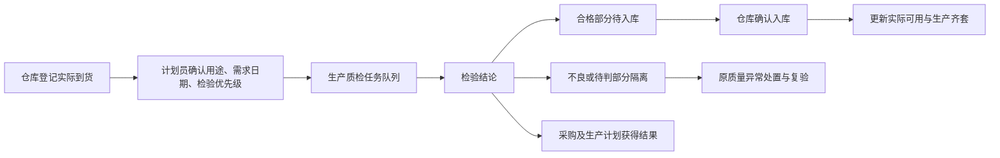

# 生产与质量模块最终整改方案

版本：V1.1｜日期：2026-10-08｜用途：需求评审、开发拆分与验收依据

实施进展另见 [第一批实施记录与闭环取舍](2026-10-08-production-implementation.md)。本文保留需求基线；不得将全部整改项视为已实现。

V1.1 补充：用户明确允许推翻生产页面现有静态内容和布局，包括驾驶舱。页面结构按任务重新设计，不再以沿用现有卡片、页头、标签和排版为前提。详见 [页面布局重构专项方案](2026-10-08-production-layout-redesign.md)。

本方案结合 14 张原型、会议整改意见、当前项目代码及本轮补充确认整理。本轮交付需求方案，不修改业务代码、不操作业务数据。文中的“已有”指代码中存在相应实现，不代表本轮已完成运行验收；“新增/调整”均为后续开发范围。

## 一、整改结论与适用边界

采用“保留现有真实业务链，补齐关键节点，统一页面入口和数据口径”的方案。重点解决五件事：

1. 来料从仓库通知开始，经计划员确认用途和检验优先级，进入生产侧质检，结果回到采购、仓库和生产计划。
2. 生产按工序派工、报工；整机完工以性能检验及最终闸门检验通过为依据，与 QA 放行、包装和发货分别记录。
3. 现场不良减少手工输入，同一异常贯通现场判定、部门协同、接收确认、处置、复验和关闭。
4. 统一用户可见名称，同时保留生产单、派工单、来料批次、检验单等独立身份，形成完整追溯关系。
5. 14 张页面按业务职责重新组织，复用真实接口和可靠基础控件；驾驶舱、静态内容、卡片和页面结构均允许重构，清理正式入口中的示例数据及重复业务入口。原型作为业务内容参考，不作为必须照搬的布局。

### 1.1 冲突处理顺序

本轮用户明确确认 ＞ 会议明确结论 ＞ 原型内容 ＞ 本方案建议。原型中的按钮、演示数量、示例人员和文案不直接视为已确定业务规则。

例如：P01“按最终装配确认整机进度”的旧说明必须修改；P02 默认“尺寸超差”不再作为现场快捷登记主项；S06/S10 的旧供应链导航不再决定质检业务归属。

### 1.2 已明确的业务决定

| 事项 | 最终口径 |
| --- | --- |
| 整机完工 | 已完成性能检验测试，且最终闸门检验通过。仅装配完成不算完工。 |
| 完工与 QA 放行 | **闸门通过算完工，QA 放行单独记录。**已完工可以处于待 QA 放行状态。 |
| 本月整机完工 | **按实际完工日期统计，包含往月生产单在本月完成的产品。**另外单列本月计划完成率。 |
| 计划审批职责 | **确认关联生产单/备货用途、需求日期及检验优先级，不判断质量合格与否。** |
| 来料检验归属 | 业务归生产与质量；仓库保留到货登记、送检、入库/隔离操作；采购可查看结果并办理供应商事项。 |
| 包装 | 按批次办理，与单台完工分开。 |
| 现场登记 | 派工自动关联生产信息，优先选项、照片/视频，保留数量和来源。 |

### 1.3 本期范围与建议边界

会议明确的整改、原型已有的关键闭环、必要的数据一致性与权限控制均纳入本期。扫码登记作为后续增强项，不能成为照片/视频快捷登记上线的前置条件；AI 原因建议仅作为可选辅助，不自动认定原因或关闭异常。

不在本期扩大建设自动产能排程、全新 MES、完整供应商评分体系或重新开发 ERP。会议提到的“1—2 个月”作为数据完善后的试用观察窗口，不作为开发工期承诺。

## 二、当前项目核查结果

### 2.1 可复用与需要补齐的能力

| 能力 | 当前代码证据与现状 | 整改方式 |
| --- | --- | --- |
| 生产计划、批次、派工、报工 | 已有真实生产执行 API、批次和任务关联、负责人/产线、报工数量限制及操作记录。 | 扩展工序定义、前后工序关系、工序数量和交接规则，保留现有主链。 |
| 计划检索 | 现有列表支持产品/型号文本搜索及跨月范围；日程支持产线、负责人、批次筛选。 | 增加独立产品型号筛选，贯通总览、计划、日程和全部任务。不是从零增加搜索。 |
| 用料缺口与采购 | 已有齐套、库存占用、按日期核对采购预计供给、采购分配到批次等能力。 | 增加到货待审批/待检/检验完成/待入库状态，保持预计供给与实际可用分列。 |
| 采购收货与检验 | 已有采购订单行关联、分批收货、检验历史、合格/不良/待判定数量、版本冲突控制。 | 补计划审批节点、检验队列优先级、检验附件及生产计划反馈。 |
| 仓库及 ERP 入库 | 已有收货、退料、隔离/冻结等处理和 ERP 采购入库写入/核对能力。 | 从新流程复用；区分本地确认、ERP 同步中和已核对，不重复计库存。 |
| 现场不良 | 已有从报工绑定异常、实领来料批次、文件附件和重复登记约束。 | 快捷选项、现场媒体体验、优先级、初步原因、负责人初判；调整必须先有完整报工才能提报的限制。 |
| 异常协同 | 已有指定经办、处理意见回传、处置与复验。当前转派即变更经办，未见独立接收确认节点。 | 增加待接收、接收、退回及协同人；保留原异常和历史。 |
| 检验与完工统计 | 已区分过程检、终检、历史未分类检验；现有完成量仍主要基于整机检验合格量及有效复验量。 | 新增性能/最终闸门关联与唯一完工事件，禁止直接把现有完成量换个名字当新完工指标。 |
| 设备检验/电子闸门 | 有真实设备检验上传、UID/SN、规则版本及历史；电子闸门有规则管理。已查设备记录模型未见生产单关联。 | 将已验证的设备记录关联生产单和检验阶段；明确何种设备记录满足最终闸门，不能把规则发布当闸门通过。 |
| 转产、ECN、批次档案 | 已有受控文件、版本快照、ECN 发布/阅读确认/反馈、批次软硬件范围、放行及发货记录。 | 补 SOP 日期、ECN 执行验证、跨链路档案汇总及全局检索。 |
| 部分独立页面 | `InspectionReleasePage`、`EBPRPage`、`QATraceability` 可见示例数组/本地状态；另有仅开发环境使用的 Preview 页面。 | 整理为真实业务入口或真实档案视图。示例页不作为功能完成依据。 |

### 2.2 本次发现的重点问题

1. **口径问题：**当前整机完成汇总包含历史未分类检验，不能据此证明性能及最终闸门均通过；质量放行也仍依赖现有检验汇总，需共同调整。
2. **数据关系问题：**派工任务虽有产线和名称，但不等于完整工序路线。同一批每个工序都按整机产出累计，会重复计算完工，且与现有整机任务总量限制冲突。
3. **流程问题：**收货可直接记录检验，缺少本次确认的计划审批；异常转派缺少接收确认，处理人与协同人也未完整分开。
4. **入口问题：**真实业务工作区与独立示例页、原型预览同时存在，容易产生“页面有、流程无”或重复登记。
5. **追溯问题：**已有基础关系，但设备检验与生产单、采购到料与检验优先级、跨页面同一异常需要补齐。部分现场异常的批次展示还混入生成的现场登记标识，应拆开显示。

## 三、页面归属与逐页整改清单

保留项目“生产与质量”主分组。其下形成生产总览、生产计划与执行、检验任务、不良与协同、转产与批次档案等业务入口；生产全部任务作为统一聚合入口。电子闸门、设备检测记录作为专业能力复用，不重复造检验台账。

仓库工作台仍属于仓储操作入口。S10 可从仓库和检验任务两处进入同一业务对象：仓库看到收货/入库操作，质检看到检验操作，计划员看到审批/优先级操作。

| 原型 | 最终定位 | 新增/修改/删减 | 关键验收 |
| --- | --- | --- | --- |
| **P00 生产管理总览** | 管理人员看进度、异常及待办 | 分开展示本月实际完工、本月计划完成率、装配完成、待闸门、待 QA、待包装及净发货；补到货待审批/待检提醒、风险跳转。趋势按真实事件日期统计。在岗人数若无可靠人员数据源显示“未接入”。 | 同一台多次复检只计一次完工；跨月完工计入实际发生月；指标可下钻到记录。 |
| **P01 生产计划与派工** | 计划员编制和分派 | 增加型号筛选、工序/产线/负责人、前序条件；展示缺口对应采购单行、预计到货、实收、审批和检验状态；修改装配即完工的旧提示。 | 缺料可定位采购来源；工序可分到不同产线；重复点击不重复派工。 |
| **P02 现场任务与不良登记** | 现场快速报工及提报 | 自动带出生产单号、派工单号、工序、产线、产品；快捷项为外观、性能/气密、装配干涉、其他；取消默认尺寸登记项；保留来源/数量，加入照片视频、可选初步原因及优先级。支持当场提报和报工后补登记两条入口。 | 不手填生产单号；手机可上传；未完成报工也能登记现场异常，后续能核销关联且不重复计数。 |
| **P03 生产检验与复验** | 统一质检任务中心 | 增加原料/来料检验入口；区分来料、过程、性能、最终闸门及复验；显示需求日期和优先级；初检、复验、QA 放行分别记录。 | 待计划审批的来料不可直接正式开检；复验不改首次合格率；通过检验不自动发货。 |
| **P04 生产问题转研发** | 不良单的研发协同视图 | 共用 P08 原异常；增加现场初判、接收确认/退回、主经办与协同人、期限、研发回复和现场验证；推广为跨部门协同能力，研发保留专用视图。 | 接收方可退回并写原因；回复不自动关闭异常；发起人可看完整进度。 |
| **P05 转产确认与批次档案** | 转产门禁与追溯入口 | 保留受控版本与问题复验门禁；补文档日期、生产单统一展示及采购/来料/领退料/工序/检验/闸门/ECN/包装/放行/发货关联；提供跨计划档案检索。 | 资料不齐或阻断问题未关闭不能转产；能从生产单查全链及历史版本。 |
| **P06 生产全部任务** | 跨业务统一待办 | 聚合计划审批、派工、报工、来料检验、生产检验、异常协同、ECN 确认及档案事项；按型号、产线、经办、状态、优先级、期限筛选，显示跨月未完。 | 数量和原页面一致；操作跳到同一实体；新建按业务类型和权限，不产生无关联通用任务。 |
| **P07 批次计划与工序安排** | 生产单的工序排程详情 | 工序可配置，分配产线/负责人/日期/数量/顺序；增加交接、返工、变更记录；保留手工排程和齐套依据。原“批次计划”主对象展示为生产单。 | 三条产线依工序连续流转，最终只产生一份整机完工数量；调整已下达计划须记录原因。 |
| **P08 生产不良处理** | 生产异常处置主页面 | 增加现场负责人初判、主经办、协同人、接收状态、优先级文字与色标；支持现场整改/研发/采购等去向、部分处置、复验及关闭。 | 全数量有最终去向才关闭；复验失败回到处理；Top10 发生次数与不良件数分开。 |
| **P10 ECN 变更查看与确认** | 版本变更执行 | 阅读确认、执行验证、归档分开；显示生效生产单/批次范围及日期，受影响岗位、旧料处置、SOP/SIP 版本；供应商通知与采购任务互链。 | 点“本人确认”不会关闭 ECN；旧生产单保留原文件快照；新版本按生效范围使用。 |
| **S06 来料质量与原因分析** | 生产与质量下的来料质量分析 | 迁入生产质检业务导航；采购/供应商页面保留关联入口；区分待确认原因与已确认根因；关联生产影响；支持同类物料、同期间供应商比较。 | 同一异常在来料和现场关联展示不重复累加；根因待确认不会被统计为已认定责任。 |
| **S10 收货检验与入库** | 仓库—计划—质检共享详情 | 流程调整为收货通知→计划审批→检验→合格入库/不良隔离；关联采购订单行、分批到货、需求生产单；增加图片/视频；结果反馈采购和计划，ERP 状态独立。 | 60 件实收、56 合格、4 不良时，待入库与隔离数量正确；审批或检验不自动增加可用库存。 |
| **S11 生产退料接收** | 仓库退料核对 | 复用现有退料及签收关系；自动关联生产单、派工单、领料单及实领 LOT，关联不良单；良品/不良/待判分流，补媒体及差异处理体验。 | 不良退料线边减少、隔离增加、合格可用不增加；不能重复退同一数量或超退。 |
| **S16 质量异常处置详情** | 跨来源质量异常共享详情 | 与 P08 共用异常实体/处置/复验服务，按来料或生产来源展示对应字段；增加协同及接收、原因确认、优先级、库存影响、生产影响和采购关联。 | P08/S06/S16 状态一致，无第二张重复异常；库存处置由对应仓储动作落账。 |

说明：未提供 P09，不纳入本次逐图评审。SOP 日期改造覆盖上述页面里的文件查看入口，不要求额外新增一个独立页面。

## 四、业务流程及异常路径

### 4.1 来料：到货通知—计划确认—检验—库存与计划反馈

1. 仓库按采购订单行登记实收、供应商、送货单、来料批次、数量及媒体。支持分批到货。签收即表示物理到货，不能等待检验才把采购状态改为到货。
2. 自动建立待计划审批项。计划员确认分配至一个或多个生产单，或明确“日常备货/暂无指定生产单”；记录用途、需求日期、分配量和优先级。无明确生产单的备货到料也必须能送检。
3. 审批通过才进入正式待检队列。信息不完整时退回仓库补充，保持原实际到货事实；不通过不等于“未到货”。审批超期提醒计划员及其负责人，不自动批准或绕过审批。
4. QC 记录合格、不良、待判和未检数量及证据，可分批完成。每次检验保留历史；部分结果反馈对应数量，未检部分继续排队。前端明确现有“本批累计结果”填报口径，防止与单次增量混用。
5. 结果同时可在采购、计划、仓库查看并形成站内待办/通知。合格入库后更新实际可用，不良进入隔离与异常处置。ERP 同步失败不丢失本地记录，允许按原请求重试和核对。

**数量与供给约束：**同一到货分配量不能超实收，采购分配继续按订单剩余可分配量核对；已到货从在途扣减后，待检数量单独可见，不能在途和待检重复覆盖。合格待入库可显示预计可用，但不计已可领。待判、隔离、冻结不计合格可用。

“流程终点为生产计划”落实为计划能收到结果、重新计算齐套/缺口并安排后续生产，不以系统发出一条通知作为闭环完成标准。

### 4.2 生产：按工序派工与真实完工

推荐生产关系：月度计划 → 生产单 → 工序任务/派工单 → 报工 → 对应检验。一个生产单可有多道工序、多条产线、多次报工。

工序需要名称、顺序、前序、产线、负责人、计划日期/数量、单位、检验要求及交接条件。产线不是工序，不能用“一线/二线”代替工序编号；跨产线仍继承同一生产单。

1. 计划员编制生产单及工序路线，按日和产线派工。缺料、ECN 待确认、受控文件缺失以明确原因提示；具体开工门禁跟随工序要求。
2. 产线接收任务并报工，区分本次产出、合格、不良、返工及交接数量。后工序仅使用前序已交接且符合条件的数量；允许分批交接，不能要求整批做完才全部流转。
3. 同一产品经过多工序只累计各工序进度，不重复累计整机产量。只有唯一的最终完工判定产生整机完工事件；领料/消耗绑定实际领用或消耗工序，不能每道工序再扣一次完整 BOM。
4. 整机完成装配后进入性能检验及最终闸门；两者有效通过后记录完工。返工、替换或复检沿原对象追加历史，不能新增一台“重复完工”。
5. QA 放行、批次包装和实际发货独立办理。包装要求与 QA 先后可由现行业务规则配置；本期至少保留批次包装状态、数量、人员和日期，发货受有效 QA 放行及包装/出货条件约束。以上包装记录字段为配套建议，不新增复杂包装工艺模块。

**与已有检验设备对接：**复用设备记录的 UID/SN、检测时间、规则版本和结果。新增生产单/检验任务的可靠关联；人工补录须有证据、人员与时间，不能把“上传了一份记录”当“最终闸门通过”。UID 已校验时优先作设备身份，SN 作业务关联；缺少可靠身份的记录进入待关联队列，不凭同型号自动分配生产单。

不要直接修改已存在的设备上传契约使在用工作站失效；关联可先在服务端建立，兼容现有客户端。性能与闸门若来自同一设备报告，须明确其分别覆盖的检验项，只有均满足时才能产生完工。

### 4.3 不良：快捷提报—初判—协同接收—处置—复验—关闭

字段与规则：

| 字段组 | 方案 |
| --- | --- |
| 自动带出 | 生产单号、派工单号、产品/型号、工序、产线、登记人；从任务进入不允许改到无权限生产单。 |
| 必填业务信息 | 不良来源、现象类别、数量；选择“其他”时补简短描述。默认任务现场来源，可按实际改为来料问题线索等。 |
| 媒体 | 支持现场拍照、相册选择、视频上传和预览，保留关联文件 ID；非所有异常强制视频。建议图片 10MB/张、视频 50MB/个，作为本期页面约束复用现有附件能力；需前后端一致校验。 |
| 初步原因 | 可选：待分析、疑似来料、软件、装配、工艺、其他。与已确认根因分字段，不能用猜测直接影响供应商责任统计。 |
| 处理跟踪 | 主经办、协同人列表、接收人/接收状态、优先级、截止日期、当前节点和操作历史。 |
| 来料批次 | 从该派工实际领料记录选择，可多个；未能识别时“待确认”，后续补齐。不手工填生产批次替代 LOT。 |

现场负责人按产线/工序配置，会议中的“负责人（大）”不硬编码为某个账号。建议质量角色负责专业判定，现场负责人负责组织初判和路由。

当前报工后不良入口可以继续复用；同时新增“现场即时登记”模式，先绑定派工，后绑定报工或检验。数量随关联校验，原已登记异常优先关联，不重复创建。部分数量分次处置保留明细。

转交后进入待接收。推荐主经办在接收前仍保留原责任人，接收成功再切换；拒绝/退回须说明原因，责任不悬空。协同人可以补充证据及意见，但不自动取得质量判定/关闭权限。

关闭须满足：受影响数量均有可验证去向，必需复验已通过，退料/报废/换货等关联动作已完成，阻断事项已解除。采购回复“已联系供应商”或研发回复“已修改”均不等于质量闭环。报废、退货等非复验恢复合格的去向走处置验证，不伪造合格复验。

P02、P03、P04、P08、S06、S16 共用同一异常主记录；跨页只增加关联/协同记录，不重复计入不良件数。一次异常有多个现象可分项统计，但现象发生次数不能标成不良件数。

## 五、名称、数据关系与指标

### 5.1 名称统一方案（推荐执行口径）

| 业务对象 | 页面统一名称 | 保留理由及规则 |
| --- | --- | --- |
| 当前生产执行中的 batch 主对象 | **生产单号** | 沿用既有内部 ID 和 B 类历史编码，不为改名重编历史单据；产品型号、数量和计划日期归此对象。 |
| 产线/工序下达任务 | **派工单号** | 一个生产单可有多个 DO 类派工任务；不能与生产单号合并。 |
| 供应商原料来源批号 | **来料批次** | 保留 LOT 及供应商批号，关联采购行、收货、领退料与异常。 |
| 报工、检验、异常 | **报工单号、检验单号、不良单号** | 各自唯一身份，共同关联生产单/派工单。 |
| 成品实物追溯 | **成品批次 / 设备 SN（UID）** | 与生产单相关但不是同一字段；实际独立成品批号存在时保留，不能强行一一等同。 |

原“任务单号”在具体场景改为实际类型名称；P06 聚合表可使用“任务编号”，同时显示业务类型和关联生产单号。数据库外键和历史编号不进行全局字符串替换。

来料可分配多个生产单，一个生产单也可使用多个来料批次；通过分配/领料明细建立多对多关系。生产单与现有备货任务单保持独立，采购供给与领用关系将二者连接，不能把备货任务重命名为生产单。

### 5.2 指标字典

| 指标 | 计算口径 |
| --- | --- |
| 本月整机完工 | 完工日期在当月、性能检验及最终闸门均有效通过的去重整机数量。包含跨月生产单本月完工；QA 状态不影响是否曾产生完工。 |
| 本月计划完成率 | 归属于所选月份生产计划的有效完成数量 ÷ 该月计划目标。分子与分母必须同范围，不能用“本月实际完工”直接除当月计划目标。显示统计截至时间。 |
| 本月计划剩余 | 本月计划目标减该计划范围有效完成量，不含其他月份订单的完工抵扣。 |
| 待 QA 放行 | 已有效完工但尚未有效放行的数量。 |
| 待包装 | 已完工且未完成批次包装的实际数量/批次，明确单位；不将整批包装状态当单台工序进度。 |
| 实际净发货 | 实际出货记录扣有效冲销，沿用现有出货链；与完工分开。 |
| 首次最终闸门合格率 | 首次接受该项检验的整机中首次通过的数量 ÷ 首次接受检验数量，按首次检验日期统计。复验通过不回写首次结果。旧终检统计独立保留，不能无证据改标“闸门”。 |
| 来料件不良率 | 同口径实际判定不良件数 ÷ 实际检验件数；抽检场景按抽检数量，不将抽检不良率直接当整批不良数量。按件、批统计分开。 |
| 可用库存 | 明确仓库/组件范围、数据来源及时间，并扣除适用的占用、冻结、隔离及待过账限制。缺数据为“待核对”，不显示假零。 |

**时间及更正规则：**业务月份按北京时间。延迟上传采用有效检验/完工业务时间，保留接收时间；不能以接口接收月替代完工月。错误检验结论撤销时保留原事件并作有理由的更正，刷新受影响统计；正常完工后的售后返修不自动抹掉历史产量。最终校验策略应覆盖重复上传、跨月补录与重新检验。

**库存 Tooltip 文案要求：**每个关键库存值可展开“来源（ERP/人工）、更新时间、仓库/范围、账面值、扣减项、最终可用值”。示例：“组件实际库存：来源 ERP，更新于 10-08 14:30；合格账面 120 件，其他计划占用 20 件，冻结 5 件，可用于本次核对 95 件。待检、隔离及在途不计入当前可用。”示例仅说明格式，页面必须代入实际数据。鼠标悬停、键盘聚焦和手机点按均可查看。

现有齐套需求使用“尚未检验合格整机需求”，整改时必须重新核对它与实际物料耗用的关系：新增闸门等待阶段不能导致已装配耗料的产品再次产生相同原料需求。物料需求按生产/耗用关系核算，完工指标按质量阶段核算，两者不能机械共用一个完成量字段。

## 六、档案、受控文件与供应商质量

### 6.1 一键追溯

按生产单号、型号、SN/UID、来料批次或采购单查询；从一个生产单展示：计划来源 → 工序派工/报工 → 采购/收货/来料检验 → 领退料 → 不良及协同/复验 → 性能和闸门 → QA 放行 → 包装/发货，并展示当时使用的图纸、BOM、SOP、SIP、ECN 及软硬件版本范围。

第一期“一键查询”定义为一次检索聚合相关记录、可跳转原单据，不强制把所有大视频和附件打包下载。建议另提供档案索引导出。权限不足的来源显示受限提示，不能通过追溯接口越权读取附件。

现有 eBPR 和全链路追溯独立示例页应改接上述真实关联，或合并为真实档案视图；不维护第二份检验、报工和放行数据。

### 6.2 SOP 与 ECN

SOP 展示版本号、发布日期、生效日期（有则展示）、当前状态和适用范围。日期来自受控版本记录，不取页面打开日期或任意上传时间；历史缺日期显示“未登记”。派工冻结适用版本及日期快照，后续新版本发布不覆盖旧单据依据。

ECN 阅读确认、岗位执行和质量验证分别记录；影响未结生产单、库存旧料、供应商供货时需有明确处理意见及关联任务。发布、确认、验证、归档均保存人员时间。对现有库存不做“发 ECN 即自动替换”的处理。

### 6.3 供应商质量

本期把来料检验、不良原因、影响生产单、处理时长及重复问题连到供应商视图。比较限定同类物料、单位、检验方式及统计期间；样本少或原因待确认要有提示。供应商完整评分权重与淘汰规则另行定义，不由这次会议自动引入。

## 七、权限、同步与历史兼容

### 7.1 角色动作

| 角色 | 主要动作 | 边界 |
| --- | --- | --- |
| 仓管 | 到货登记、送检资料、入库/隔离、退料核对 | 不代替 QC 判定合格；不代计划员审批用途。 |
| 计划员 | 用途/优先级审批、生产计划、工序派工、供给分配 | 不修改 QC 结论；采购到货/质检状态只读引用。 |
| 现场人员/线长 | 接任务、报工、不良、领退料、ECN 阅读确认 | 仅授权产线/任务；不自行放行关闭质量问题。 |
| 现场负责人 | 初判、指定方向、催办和协同组织 | 初步原因不等于最终根因。 |
| QC/质量负责人 | 来料及生产检验、根因确认、复验/处置验证 | 按实际授权拆分检验、复验和关闭动作。 |
| 研发/采购等协同人 | 接收或退回协同、提交处置方案和证据 | 回复不自动改变最终质量结果。 |
| QA/授权放行人 | 独立放行、拒绝及留痕 | 放行不能绕过应满足的性能/闸门和质量阻断。 |

菜单迁移同时改页面权限与服务端动作权限，不能仅移动侧栏。沿用现有权限体系，新增动作只补必要权限；对旧质量权限做好迁移映射，避免迁移后仓库突然可判质或质检失去入口。

### 7.2 同步与一致性

使用同一业务实体供不同角色查看，通知只负责提醒。关键命令保留现有请求幂等、版本校验及审计记录。ERP 写入沿用已有服务，不因新增生产入口新建第二条同步链。

清楚显示“已在本系统完成 / 待同步 ERP / 同步中 / 结果待核对 / 已同步 / 失败可重试”。已回写后 ERP 库存刷新必须抵消对应本地过渡数量，防止双计。ERP 未支持的业务节点留本地可追溯记录，不能显示虚假同步成功。

### 7.3 历史数据处理

1. 保留既有内部 ID、单号、文件和审计记录；名称修改不修改单据身份。
2. 对已有计划/派工建立清晰映射。缺工序关系的历史任务标“历史工序待补齐”，不凭任务名自动推导全部工艺。
3. 历史 final/legacy 合格数据仍可查，但没有性能/最终闸门证据时不补造“已过闸门”。在新旧指标切换前生成对账清单，人工确认可映射的证据；未补齐单独展示。
4. 已入库的历史收货记录不倒退重走计划审批；新审批流程从启用后的记录及适用未完成记录开始，迁移规则留痕。
5. 上线前做新备份、迁移演练和新旧数量对账；出现问题可停用新增入口并回滚兼容代码。已有本地数据库压缩包只是先前快照，不能代替上线时的新备份。回退不得删除启用后已产生的业务事实。

## 八、页面布局重构及交互整改原则

本次根据原型和代码确认改造方向；未对所有真实页面重新做浏览器逐屏验收，因此以下是待实施的统一规范与验收项，不宣称已发现或修复所有当前渲染问题。

用户已授权重构现有生产页面，包括驾驶舱。这里的“复用”是复用真实业务能力、基础控件和必要的品牌识别，不要求沿用现有页面骨架。具体推荐布局及各页面映射见专项方案。

1. **按任务重新组织结构：**驾驶舱、排程、现场录入、检验和档案分别设计，允许拆分原大页面、合并重复区块、重排导航以及替换静态卡片。原型中的月度出货横条不机械复制到每个不良/收货表单，仅保留与当前任务有关的信息。现有 Horizon 容器或标签结构若妨碍使用，可以替换。
2. **统一字段与动作：**生产单号、派工单号、来料批次固定命名；输入单位靠近数值；主按钮随角色和节点变化，禁用时显示原因。错误靠近对应字段，保存失败保留内容。
3. **现场简化：**桌面可左右分栏；平板/手机拆为“报工 / 登记不良”标签或步骤，避免两套密集表单并排；媒体有缩略图、视频标识、上传进度与失败重试。
4. **清晰状态：**红色高优先/阻断、黄色待处理/提醒、绿色合格/完成，同时有文字及图标；协同待接收与处理中分开。提示框可点击/聚焦，不能只靠悬停或颜色传递信息。
5. **真实数据状态：**覆盖加载、空列表、接口失败、无权限、历史未补齐、待 ERP 核对。返回列表保留筛选和滚动位置，长表格与弹窗不截断内容；脏表单离开提醒复用现有能力。

## 九、开发顺序与交付包

功能闭环仍优先，但布局重构是独立交付项，不能留到最后仅调整间距和颜色。先完成驾驶舱、计划排程、现场录入、检验工作台四类代表页面的结构设计，验证信息层级与关键操作，再随各功能交付包落地，其余页面复用经验证的布局模式。以下为依赖顺序，不是工期承诺。

| 顺序 | 交付包 | 完成标准 |
| --- | --- | --- |
| **1：统一基础与来料闭环** | 名称映射、角色菜单、来料通知/计划审批、QC 待检队列、媒体、采购/计划反馈及库存状态 | 一笔分批到货从仓库流转至生产计划，合格与隔离数量、采购履约、ERP 状态相互一致。 |
| **2：现场与不良闭环** | 快捷登记、即时/报工后登记关联、初判、协同接收/退回、协同人、复验关闭；P04/P08/S16 共用数据 | 一张异常跨部门流转、部分处置与复验后正确关闭，重复提交不产生重复数量。 |
| **3：工序与完工口径** | 工序路线/交接、按工序派工、设备记录关联、性能/最终闸门、月度指标、QA/包装/发货边界 | 多工序报工不重复计产；跨月、复验、迟传记录下完工及计划完成率正确。新口径完成前不切换正式完工指标。 |
| **4：档案与全面验收** | 全局档案、SOP 日期、ECN 验证、供应商质量关联、全部任务聚合、示例入口处理与全屏幕巡检 | 14 页业务映射完整，检索可追溯，权限及历史兼容通过；新布局达到专项方案的任务与屏幕验收要求，进入试用。 |

可在前几个交付包内提前补 SOP 日期和型号筛选，但不能用小字段完成代替主流程完成。正式开发任务应按此方案继续拆成接口、字段、前端与测试，未经代码改动和验证不标为完成。

## 十、验收场景

| 编号 | 场景 | 必须满足的结果 |
| --- | --- | --- |
| A01 | 采购 100 件分两次到 60/40 件；首批 56 合格、4 不良 | 分批独立可追溯；首批不因检验而重复收货；合格入库和隔离数量正确。 |
| A02 | 到货审批退回补充、再次通过 | 原实收事实不丢；通过前不可正式开检；任务及记录不重复。 |
| A03 | 到料供两个生产单及日常备货 | 关联/用途均能表达；分配不超量；缺口及优先级按各自需求可见。 |
| A04 | 到货、检验、入库、ERP 回写按不同时间完成 | 在途、待检、合格待入库、已可用分列；ERP 刷新不双计；失败重试不重复单据。 |
| B01 | 现场仅完成部分生产，即时发现 3 件不良 | 可拍照/视频提报，自动继承派工；后续报工/检验关联原异常，不另计 3 件。 |
| B02 | 报工 160、合格 154，不良 6 件后补登记 | 已报工不良缺口与登记量一致；不能重复或超量登记；原有补登记能力保留。 |
| B03 | 现场负责人转研发，研发退回后转采购接收 | 主责任不悬空；每次接收/退回有记录；协同人权限不越界。 |
| B04 | 6 件中 4 件返工合格、2 件报废 | 对应复验与报废验证齐全才关闭；4 件按原对象恢复，不新增 6 件完工。 |
| B05 | 同一异常显示于 P08、S06、S16 | 共享状态/附件/协同历史；件不良数不重复，现象次数另列。 |
| C01 | 同一生产单 100 台经过三条产线、分批交接 | 各工序进度独立；累计整机完工最多对应 100 台实际对象，物料不按三次完整 BOM 扣减。 |
| C02 | 装配合格，性能或闸门未通过 | 不计整机完工；性能和闸门通过后计完工，QA 未放行仍单列待 QA。 |
| C03 | 9 月单在 10 月完工 20 台 | 10 月实际完工增加 20；不无条件增加 10 月计划完成率分子。 |
| C04 | 首检 50 台、47 通过，后续 2 台复验通过 | 首次合格率仍为 94%；有效通过数量可增加，但同设备不重复计完工。 |
| C05 | 同一设备重复上传/迟传、无 UID 或关联错误 | 重复不增量，迟传按有效业务日期；无可靠身份待关联；错误更正留痕。 |
| D01 | 不良退料 6 件、多次点击确认 | 只记一次线边减少和隔离增加；合格可用不增加；不能超实领批次净数量。 |
| D02 | SOP 新版本发布、ECN 点本人确认 | 历史单仍展示原版本和日期；阅读确认不等于执行验证或 ECN 归档。 |
| D03 | 通过生产单、SN 和来料批次分别检索 | 可定位同一链路相关记录，受限文件不越权；缺失历史节点明确标识。 |
| D04 | 采购/计划/QC/仓库分别登录操作 | 角色看到对应动作；服务端拒绝越权，不能仅依赖按钮隐藏。 |
| D05 | 1440 桌面、1024 平板、390 手机及慢网/失败状态 | 表单、表格、弹窗、媒体预览、Tooltip 可用；保存失败不丢输入，状态变化清楚。 |

通过必要接口/业务测试、关联回归和真实浏览器验证后，才能分别标记“开发完成”“验收通过”“已上线”。试用期间观察到货至审批、审批至开检、异常接收/关闭时长以及计划等待原因，据真实记录调整默认优先级和页面布局。

## 十一、代码核查索引与本轮交付说明

以下路径相对项目根目录 `E:/workCoding/inogi-ai-office`，便于开发人员定位复用点：

| 主题 | 核查文件 |
| --- | --- |
| 路由与真实/预览入口 | `src/app/App.tsx`、`src/app/routesConfig.tsx` |
| 生产计划、列表、筛选、现场 | `src/app/production/execution/ProductionWorkspace.tsx`、`ProductionLists.tsx`、`ProductionSchedule.tsx`、`ProductionFieldIssueDialog.tsx` |
| 生产数据、完工汇总、报工及不良 | `apps/api/src/modules/procurement/production-execution.model.ts`、`production-execution.service.ts` |
| 采购收货与检验 | `apps/api/src/modules/procurement/purchase-receipts.service.ts`、`src/app/order-processing/components/PurchaseReceiptDrawer.tsx`、`src/app/lib/purchaseReceiptApi.ts` |
| 库存、退料、ERP 入库 | `apps/api/src/modules/procurement/warehouse-records.service.ts`、`warehouse-flow.service.ts`、`erp-purchase-receipt.service.ts` |
| 齐套与供给分配 | `src/app/production/execution/ReadinessPanel.tsx`、`apps/api/src/modules/procurement/production-readiness.service.ts`、`readiness-purchase-allocation.model.ts` |
| 质量处置与复验 | `apps/api/src/modules/procurement/procurement-operations.service.ts`、`quality-verification.service.ts`、`src/app/procurement/quality/QualityRecordsPanel.tsx` |
| 转产、ECN、档案、放行 | `apps/api/src/modules/procurement/production-lifecycle.service.ts`、`production-lifecycle-records.ts`、`src/app/production/execution/LifecyclePanel.tsx`、`LifecycleControlledDocuments.tsx` |
| 设备检验记录 | `apps/api/src/modules/device-inspection-records/device-inspection-records.service.ts`、`device-inspection-records.contract.ts`、`apps/api/prisma/schema.prisma` |
| 需要改接真实业务的独立页面 | `src/app/InspectionReleasePage.tsx`、`src/app/EBPRPage.tsx`、`src/app/QATraceability.tsx` |
| 附件能力 | `src/app/lib/resourceUpload.ts`、`apps/api/src/modules/oss/oss.constants.ts` |

本轮已核对全部 14 张所附原型和上述关键调用链，已纳入用户对完工、月度统计及计划审批的三项补充确认。未进行新业务开发、数据库迁移、ERP 写入或全页面浏览器验收；后续阶段不能引用本方案代替这些验证。

实际采用的技能：ponytail，用于优先复用现有能力、约束重复建设；i-have-adhd，用于结论优先、分步组织和明确交付状态。现有代码修改及先前优化结果保持不动。
