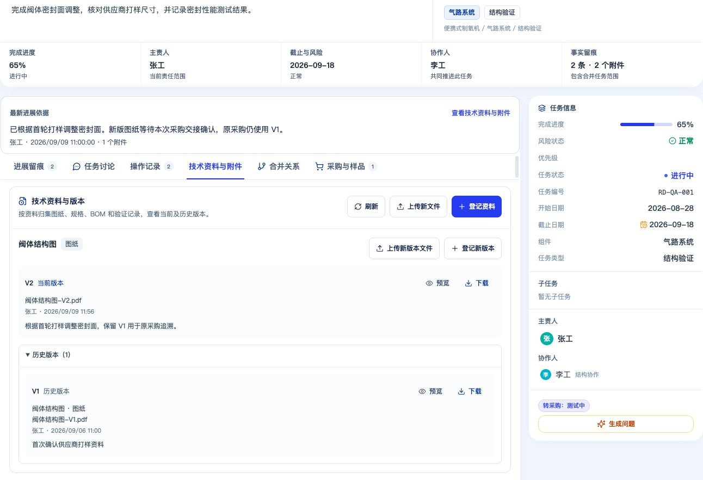
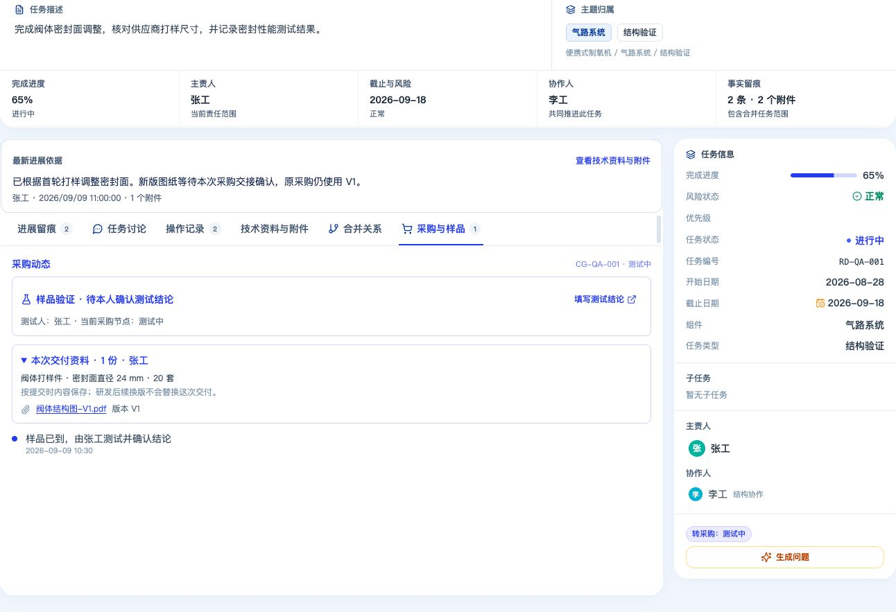
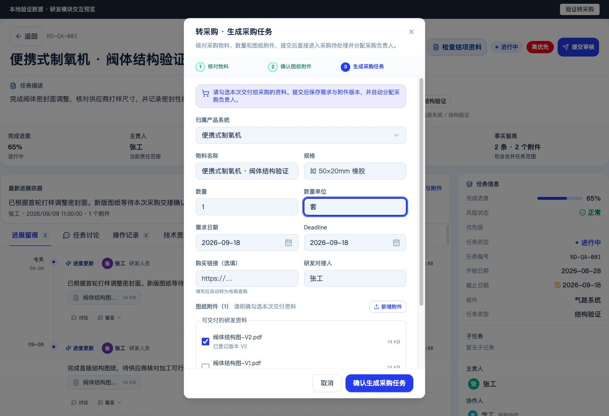
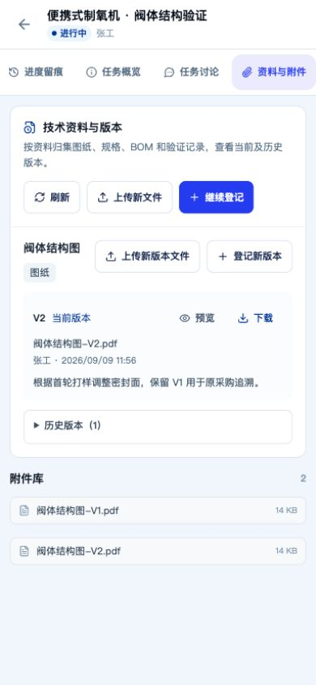
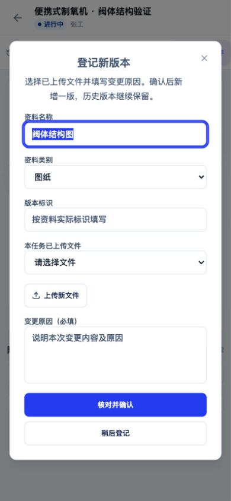

# 研发模块 V1.1 实施与验收记录

日期：2026-09-09。根据用户确认的五项修改范围实施，现有生产和美国协同工作区继续沿用原流程。

后续状态：同日已完成本地数据库迁移及服务启用，详见 [本地启用记录](local-activation.md)。下方测试数据截图仍是开发验收截图，不代表当前实际业务数据。

## 已实施范围

| 范围 | 当前行为 |
| --- | --- |
| 任务可见范围 | 本人主责、协作任务可读；主管和明确授予跨任务读取权限的人员按权限读取。列表、统计、详情、附件、操作记录使用服务端范围校验；只读权限不授予资料维护权。个人工作台账号可以进入研发任务详情。 |
| 任务详情 | 展示主责、协作、进度、截止与风险、最新进展依据；保留原任务操作，将资料、采购与样品入口放在原详情内。 |
| 技术资料 | 图纸、规格、BOM、验证资料、其他五类；用户明确确认版本、来源文件和变更原因。新版本保留历史文件和历史名称、分类、确认人、时间。现有附件继续可用。 |
| 转采购交接 | 明确勾选本次文件及版本，保存数量单位、规格等需求和文件快照；同一文件登记多个版本时仍可分别选择。后续研发换版不会替换已经提交的采购交接。撤销后重新提交保留历史交付。 |
| 样品闭环入口 | 研发详情读取已有样品流程的状态、测试人和结论，并进入原有授权测试入口。仅打开页面不会视为测试完成。 |

新文件上传复用原留痕上传流程，不填写任务进度，不会因上传资料改变完成进度。登记成功产生“确认资料版本”操作记录。请求重试保持提交编号，重复点击不会产生重复版本；版本冲突保留草稿并要求重新核对。

研发之外的共享工作区不显示这次新增的技术资料和交接快照操作。完整 ECN、批次生效、生产问题闭环、ERP/库存、采购后续换版审批与全站改版不在本轮范围内。

## 验证结果

- 前端类型检查、后端类型检查、前后端生产构建通过；改动空白检查通过。
- 前端相关回归合并运行 **150/150 通过**：资料登记和重试、转采购版本选择、样品入口与确认、任务详情状态、移动端、工作区边界和原有详情布局。
- 研发后端专项 **91/91 通过**：本人/协作/管理范围、统计与详情一致、记录和附件可见性、跨模块文件引用保护、登记和源附件变更的顺序控制。
- 转采购与附件预览最终专项 **30/30 通过**：可信版本解析、需求与文件快照、重复转交、重提保留历史、嵌入式文件保存与读取时重签、拒绝伪造版本地址。另有采购与样品相关回归通过。
- 隔离 PostgreSQL 实测 **8/8 通过**（包含父测试）：实际执行新增表迁移，测试不可变历史、重复提交、并发版本冲突、跨任务拒绝、归档只读、历史内嵌文件与操作记录。使用临时本地数据库，结束后停止并清理。
- 发现并更新三处与本轮批准行为冲突的旧静态断言，同时加强默认研发与 US/生产分支的边界检查。

合并前端回归覆盖的文件：

```text
scripts/rd-technical-documents.test.mjs
scripts/rd-procurement-transfer.test.mjs
scripts/procurement-sample-test-mobile.test.mjs
scripts/rd-task-detail-layout.test.mjs
scripts/rd-task-detail-refinement.test.mjs
scripts/rd-task-detail-request-state.test.mjs
scripts/rd-cockpit-metrics-consistency.test.mjs
scripts/rd-cockpit-navigation-regression.test.mjs
scripts/rd-production-task-detail-horizon-ui.test.mjs
scripts/mobile-rd-cockpit-horizon-ui.test.mjs
scripts/rd-workspace-people-refinement.test.mjs
scripts/rd-workspace-i18n.test.mjs
scripts/procurement-sample-test-ui.test.mjs
scripts/procurement-sample-test-messages.test.mjs
```

数据库实测命令：在项目目录运行 `node apps/api/scripts/test-rd-documents-postgres.mjs`，需要本机 PostgreSQL 工具可用。该脚本不读取项目配置中的业务数据库地址。

## 界面验收

在实际页面组件上使用独立的本地测试数据完成交互检查。截图中的任务、人员、图纸、采购和样品均为验收样例；这不是对真实业务数据库的联调结果。

- 桌面：登记 V2 前人工核对文件与原因，确认后 V2 为当前版、V1 在历史中，任务进度仍为 65%。
- 桌面：采购交接仍显示 V1、20 套及原规格，样品展示指定测试人与待确认状态。
- 转采购：初始零勾选时禁止提交；当前、历史版本各自可选，数量单位可编辑。
- 手机：390 × 844，页面和详情容器宽度均为 390，没有横向溢出；版本登记弹窗、文件预览及返回原资料页正常。











## 发布边界与已知限制

代码已完成本地验证；后续已应用到本机数据库并启动本地项目，尚未部署到线上服务器。线上发布时仍需核对目标库迁移状态，随本次 API 执行 `20260909090000_rd_technical_documents` 迁移并更新 Prisma Client，再启用前端入口。该迁移仅新增两张资料/版本表及索引，不回填或删除原附件。

工作区包含用户原有的其他未提交开发和迁移，发布前应明确此次发布清单，不能把全部待执行迁移自动视为本轮授权范围。

登记与原附件删除/替换复用项目现有的进程内写入队列；数据库事务和当前版本比较额外保护并发版本提交。若服务运行多个独立写入实例，跨实例的原附件替换/删除仍需采用共享锁后再验证，该并发场景未在本轮验收。

额外运行的 `scripts/procurement-quote-people-refinement.test.mjs` 有一项原有源码正则断言不匹配未改动的采购通用组件（`autoFocus, ariaLabel, onEnter`）。它与本轮研发变更无关，未改动该组件或放宽该断言；本记录不宣称全仓测试全部通过。
