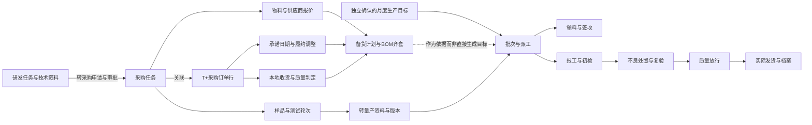

# 01 · 产品地图

审计日期：2026-09-17。对象：INOGI AI Office System 当前工作区源码及业务文档。角色视角：Principal Product Designer / UX Architect。

## 结论

这是一个围绕设备产品研发、采购、制造与交付协作发展起来的企业工作平台，同时包含人事行政、费用管理和 AI 办公工具。它已经超出“AI Office 工具集合”的范围，但尚未形成统一的业务对象与任务入口体系。

当前最完整的业务主线是“研发任务 → 转采购申请 → 采购任务与样品 → 订单行履约/收货/检验 → 生产计划与作业 → 质量放行/发货”。链路的多个部分有真实接口实现；**接口存在不代表本环境或生产环境已完成部署、角色配置、数据接通及端到端业务验收**。

目前导航的主要问题不是统一缺少功能，而是组织方式混合：部门（人事）、活动（信息流转）、资产（文件与知识）、技术（AI）和治理（系统管理）并列。同一物料、任务、文件和质量事件因而跨多个入口出现。应先明确对象的权威记录与角色任务，再决定页面的合并和拆分。

## 阅读顺序与证据边界

| 文档 | 回答的问题 |
| --- | --- |
| [02 导航地图](02-navigation-map.md) | 现有一级、二级、三级关系；隐藏入口；移动导航；命名 |
| [03 页面清单](03-page-inventory.md) | 路由完整登记；每页目的、主要功能、界面结构与接入情况 |
| [04 功能地图](04-feature-map.md) | 业务对象、API、权限、跨页流转、核心任务步骤 |
| [05 UX 问题](05-ux-problems.md) | 职责重复、错位、深层功能、合并/拆分、承载方式及优先级 |

本阶段采用源码与文档的静态产品盘点，未登录运行中的产品、未提交业务数据，也未开展截图审计、用户访谈或可用性测试。因此：

- **事实**：当前挂载路由、菜单文案、页面结构、事件处理、API 调用、权限条件及文档声明。
- **判断**：由事实推导的信息架构摩擦、对象边界和整合建议；不把设计判断说成已测得的用户失败。
- **待验证**：线上角色授权、隐藏菜单、自定义路径、真实数据完整性、使用频率、操作耗时及成功率。
- 文中的步骤为有前提的静态任务步骤计数，不是实测点击数；批量、异常、审批等待另计。
- 工作区已有他人未提交变更。本报告以阅读时可见实现为准，未修改、撤销或提交任何应用代码。

## 扫描范围

| 范围 | 已检查来源 | 产品层面的提取结果 |
| --- | --- | --- |
| routes / router | [App.tsx](../../src/app/App.tsx)、[routesConfig.tsx](../../src/app/routesConfig.tsx)、[routePaths.ts](../../src/app/lib/routePaths.ts) | 当前路径、独立页、参数详情、兼容路径、DEV 入口与移动路由 |
| pages / views | App 实际引用的页面、issue-ai、order-processing、procurement、production、expense 及 DEV 预览 | 页面目标、状态、对象与主要操作；未把同名旧文件重复算为页面 |
| layouts / navigation | [Root](../../src/app/Root.tsx)、[实际侧栏](../../src/app/components/sidebar_1.tsx)、[实际顶栏](../../src/app/components/header_1.tsx)、[MobileShell](../../src/app/MobileShell.tsx) | 默认 15 个分组、75 项；页面搜索/任务搜索、消息、个人中心、MateChat |
| components | 业务 Drawer/Dialog/Form/Table/Panel 与共享 UI 基础组件 | 识别列表内操作、完整详情、表单步骤、内嵌工作区和上下文返回 |
| permissions / roles | [权限辅助](../../src/app/lib/permissions.ts)、[导航过滤](../../src/app/lib/useVisibleNavigation.ts)、权限目录、角色默认值、后端控制器/业务权限 | 页面、动作、工作区、个人范围和知识库密级分离 |
| API | 前端 lib、页面直接请求、费用 service；对应后端 controller/service | 区分后端接入、本地演示、ERP 镜像与本地业务台账 |
| 页面标题 / Tabs / Actions / Forms / Tables | 页面 JSX、配置数组、处理函数及业务组件 | 原始命名、字段、表格列、下一步动作及确认行为 |
| Settings | 角色、用户、部门、字典、权限目录、AI/OCR/邮箱、审批流与业务内设置 | 设置入口分散、管理职责与执行职责混放 |
| package / README / 业务文档 | [package.json](../../package.json)、[API package](../../apps/api/package.json)、[README](../../README.md)、[API README](../../apps/api/README.md)、docs 业务范围和产品说明 | 技术能力与产品宣称交叉验证；不照搬过时进度 |

根 package 名称仍是 `@figma/my-make-file`，README 将项目描述为 Figma 来源的代码包；API README 的 “Initial modules” 只列最早的几个模块。它们不是当前产品范围的完整说明。技术组合为 React/Vite 前端、NestJS API、Prisma/PostgreSQL，具有文件存储、OCR、企业微信、邮箱、T+ ERP 和 AI 能力。上述只用于识别业务边界，不作技术质量评价。

覆盖核对：对 `src`（不含 `src/imports` 历史导入内容）484 个 TS/TSX 文件完成结构检索，其中 317 个 TSX 文件；对路由引用、关键业务组件和接口链路进一步阅读。路由表登记 135 项，包含布局、重定向、移动视图及 18 个 DEV 入口，不能解读成 135 个独立业务页。后端按全部模块控制器扫描接口族，再针对核心对象追到服务实现。结构扫描覆盖不等于逐行代码审查或运行验收。

## 用户提出的 12 个问题对应位置

| 问题 | 本轮回答位置 |
| --- | --- |
| 1. 核心业务模块 | 本文件“从用户目标划分的核心业务模块” |
| 2. 一级/二级/三级导航 | 02 的完整导航表和“实际第三级” |
| 3. 每页业务目标 | 03 的逐页业务清单 |
| 4. 每页主要功能 | 03 的结构/操作列，04 的对象能力与 API 对照 |
| 5. 职责重复 | 05 的 UX-04/06/07/08/10/16/22 与合并表 |
| 6. 功能放错位置 | 05 的 UX-05/12/21/24 |
| 7. 功能层级过深 | 05 的具体路径表，04 的核心任务步骤 |
| 8. 应该合并的页面 | 05 的合并候选及“不建议直接合并” |
| 9. 应该拆分的页面 | 05 的拆分表 |
| 10. Tab/Drawer/Modal/独立页面 | 05 的承载决策表，04 的原则 |
| 11. 命名一致性 | 02 的命名核对表、05 的 UX-13/14/15/16 |
| 12. 核心任务步骤 | 04 的 18 条静态路径、计数前提及跨角色交接说明 |

## 从用户目标划分的核心业务模块

下表为**产品域归纳**，并非当前侧栏分组，也不是本阶段已批准的新导航。

| 产品域 | 主要用户与核心任务 | 关键业务对象 | 当前实际入口 | 能力边界 |
| --- | --- | --- | --- | --- |
| 个人与团队任务协作 | 成员推进任务；主管分派、评审、处理阻塞 | 工作区、产品/系统类目、任务树、工作项、进展、讨论、审批、成员 | 研发驾驶舱/工作台/详情；中美协同；生产协同旧视图 | 三个工作区复用能力但数据与权限隔离；不能因复用组件就合并任务池 |
| 供应链与采购履约 | 采购员将需求变成可用物料；主管管负载和交付 | 采购任务、样品轮次、物料、报价、备货计划、订单行、收货与履约调整 | 供应链 7 项；订单与库存中的采购订单、库存 | T+ 为订单/库存来源；本地承诺、履约、检验与分派是补充台账 |
| 生产执行与质量闭环 | 计划员确认目标；现场报工；仓管交接；质量检验放行 | 月计划、批次、派工、报工、领退料、质量异常、转产资料、ECN、放行、出货 | 生产总览、生产计划与执行、生产领料；另有历史质量演示页 | 当前存在正式 API 路径，同时保留 DEV 预览与本地演示，不能混算 |
| 受控资料与知识 | 成员找资料；专业人员发布可信版本与留存证据 | 知识库、文件版本、分类、密级、比对、技术资料、资料包 | 统一知识库、协同知识库、研发技术资料、对外资料版本、法规库、DMS、BOM | 知识查找、受控发布和法规合规是不同任务；仅部分已接后端 |
| 客户与订单协作 | 客服处理询盘/售后；业务人员处理客户订货与出口单证 | 询盘、Case、订货单、商业发票、报关单证 | 询盘、售后、订货单处理、报关 AI/处理 | 订货单处理有 API；询盘/售后/报关界面主要为本地演示 |
| 人事行政与费用 | HR 招聘入职；行政维护档案考勤；员工/财务报销 | 候选人、岗位规则、登记表版本、员工、考勤、凭证、报销单 | 人事与行政 5 项、公开应聘入口 | 五条业务线均可追到后端；候选人→员工的完整自动转档不可据此假定 |
| AI 工作辅助与内容创作 | 员工问答、生成图像/视频、整理材料与复用文件 | 会话、生成任务、作品、文件选择、资料包、结项检查 | 全局 MateChat、AI 创作、邮件/会议/汇报/合同工具 | 图像/视频/MateChat 接口存在；部分办公工具为演示；MateChat V2 文档不是已交付全能力 |
| 组织治理与平台运维 | 管理员维护身份、权限、连接、审计和运行状态 | 部门、用户、角色、权限项、模型连接/路由、邮箱、字典、日志 | 系统管理、运维中心，另有业务内设置 | 治理能力分散在多个业务页；“页面路由管理”实际还维护权限目录 |

## 核心对象关系

图表示当前实现可识别的业务关联和预期责任边界，并非本次跑通的事务链。尤其不能把“采购已下单”“已到货”“检验可用”“报工良品”“QA 放行”“已发货”视为同一种完成状态。当前正式生产组件已明确区分这些数量，是后续信息架构应保留的正确基础。

人员也必须区分：登录用户、HR 员工档案、研发成员、采购负责人名录和仓管/质量任务受派人是有关联但不等价的对象。不要为了统一页面而丢掉账号身份、业务资格与历史归属。

## 角色与可见范围

| 角色视角（业务画像） | 主要工作面 | 范围/动作规则 |
| --- | --- | --- |
| 研发执行者 | 个人工作台、任务详情、讨论、样品测试 | 主责/协作归属、受邀线程；提交结果不等于批准结果 |
| 研发/协同管理者 | 驾驶舱、人员负载、审批、报表 | 页面权限与创建、转派、审核、人员管理等动作分开；协同工作区独立 |
| 采购执行者 | 采购工作台、采购任务、样品、交期 | 本人任务与全局驾驶舱范围不同；状态决定下一步操作 |
| 仓管 / 质量人员 | 我的仓管与质量任务、订单行、生产领料/检验 | 收货与检验分工；本人岗位队列并不依赖拥有全部采购管理能力 |
| 计划员 / 生产现场 / QA | 月度计划、派工、报工、初检、放行发货 | `production:plan`、`proc-production:report`、`production:release` 等按责任拆分 |
| HR / 行政 / 财务 | 招聘、登记、员工档案、考勤、费用 | 业务管理动作另有权限；对外应聘者通过公开表单填写，无内部导航 |
| 平台管理员 | 组织账号、角色、目录、集成和运维 | `*` 为超级权限；导航隐藏不是撤销访问权限 |
| 普通登录用户 | 个人资料、消息、获授权业务及 MateChat | 不能根据全权限侧栏判断普通用户信息负担 |

这些是任务画像，不是数据库现有角色列表。源码默认角色文件仅定义“研发人员”“研发管理员”；实际角色可自定义。没有读取真实用户或角色数据库，不能断言当前公司有哪些具体授权组合。参见 [默认角色](../../apps/api/src/modules/roles/roles.defaults.ts)、[角色服务](../../apps/api/src/modules/roles/roles.service.ts)、[后端权限守卫](../../apps/api/src/modules/auth/guards/roles.guard.ts)。

知识库另有库级页面权限、内容操作权限与成员分值/文件密级；统一入口不会合并存储或扩大授权。采购/生产 API 放在同一个代码目录，也不能据此认定生产业务归采购部门负责。

## 实现成熟度与文档冲突

统一使用以下标识，贯穿页面清单：

- **A · 已接接口**：当前前端业务调用可追到后端实现。不是生产可用性保证。
- **D · 本地演示**：挂在日常路由，但主要业务结果来自样例、本地状态或模拟提示。
- **P · 开发预览**：仅 DEV 构建挂载的独立演示入口。
- **R · 入口/兼容/只读内容**：路由重定向、布局、静态帮助等，按实际能力说明。

需要避免沿用的旧判断：

| 文档或命名 | 当前源码事实 | 本报告处理 |
| --- | --- | --- |
| issue-ai 旧对话文档说 mock | [IssueAiModule](../../src/app/IssueAiModule.tsx) 创建 HTTP service，后端 issues 已实现 | 归为 A；旧文档只解释交互由来 |
| 生产进度文档只记录 P00–P10 预览 | [ProductionExecutionPage](../../src/app/production/execution/ProductionExecutionPage.tsx)、[LifecyclePanel](../../src/app/production/execution/LifecyclePanel.tsx)、[ReadinessPanel](../../src/app/production/execution/ReadinessPanel.tsx) 接正式 API | 正式入口和预览分别登记，不宣称全域只有演示 |
| 仓库前端文档只记录预览 | [WarehouseFlowPage](../../src/app/procurement/WarehouseFlowPage.tsx)、[WarehouseRecordsPanel](../../src/app/procurement/WarehouseRecordsPanel.tsx) 存在实际业务调用 | 正式仓库办理与 DEV 仓库视图分列 |
| 早期采购文档说缺少样品时间/承诺历史/分派 | [最新补齐记录](../procurement-remaining-completion.md) 与相关 API/组件已补充 | 不列为当前“功能缺失”；既有历史不能追溯补造仍成立 |
| `/rd-director-dashboard` 和旧组件名 | App 重定向到 `/production-dashboard`，默认是新的生产总览；`?view=legacy` 进入生产协同任务 | 不把旧文件单算为主管驾驶舱页面 |
| `/settings` / `SystemSettings.tsx` | 实际挂载 DictionaryList，SystemSettings 未在 App 挂载 | 当前产品对象是字典，不是通用系统设置页 |

## 下一阶段验证门槛

先用研发执行者、采购员、仓管、质量、计划员、HR 与管理员各一组获授权测试账号，核验本文的可见导航和关键路径；再用真实频次判断是否需要新入口。优先验证跨角色采购交接、生产七个页签的岗位分工、非研发页面手机访问、邮箱配置来源及生产数量口径。未经验证的结构建议不直接转成开发任务。
