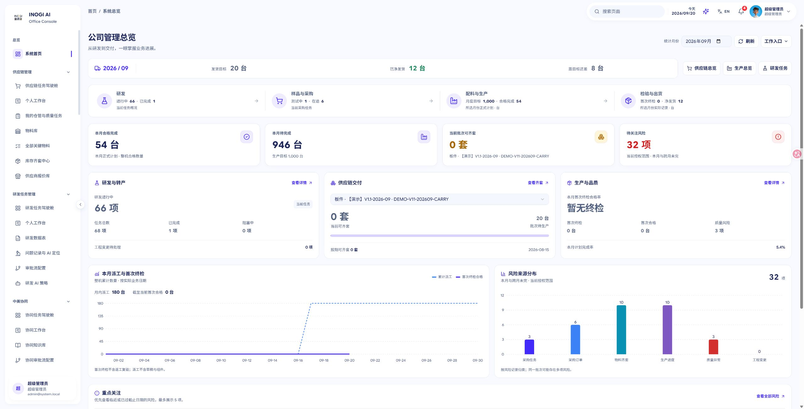

# 首页数据看板改版验收

日期：2026-09-20

用户确认：首页应为公司管理 Dashboard，呈现业务数据、进展与风险；清晰、轻量，明细放到独立视图。延续现有 Horizon 视觉、系统 UI 控件与原有权限。

## 当前布局

1. 公司管理总览：月份、刷新、工作入口。
2. 月度交付摘要与供应链、生产、研发入口。
3. 研发 → 样品与采购 → 配料与生产 → 检验与出货的业务链路。
4. 合格完成、待完成、所选批次可齐套、待关注风险指标。
5. 研发与转产、供应链交付、生产与品质三栏概况。
6. 月度派工/首次终检曲线与六类风险分布。
7. 重点风险最多 5 项，全部风险在独立视图筛选分页；原记录入口保留。

## 真实数据边界

- 生产与发货按所选月份统计；研发与采购为当前任务快照，页面分别标明。
- 齐套按所选批次显示，不把不同产品的套数相加。
- 派工曲线只统计已下达整机作业，排除草稿、取消与组件。
- 首次终检曲线汇总每段正式终检的首次合格量，排除复验增补；日明细必须与权威月度合计核对一致才绘制，避免遗漏已完成跨月作业。
- 未来实际点保留空值。来源失败、未知值和未包含的授权范围不伪装成已完成或零值。
- 暂不展示缺乏可靠统计来源的同比、在岗人数、版本时间线或质量原因 Top 3。

## 验收

- TypeScript 无错误。
- Vite 正式构建通过（31.11 秒）。
- 51 项相关测试通过：新首页行为/数据/导航、共享 UI、原单入口、生产导航与移动路由。
- 浏览器验证：原始 2560px 桌面、1440px 桌面、390px 窄屏；无水平溢出，业务内容在主体区域滚动。
- 浏览器验证：批次切换联动齐套数与原批次链接，全部风险打开独立视图，工作入口进入个人办公，返回回到数据看板并保留月份。
- 修复系统首页在窄屏被误跳到研发驾驶舱的问题；研发专属移动入口保留。
- 本地浏览器无捕获到的 error/warn。
- 独立数据与代码复核提出的统计、权限和旧筛选残留问题已修正并加入回归验证。

本次未部署，未修改业务数据。MateChat 侧边展示和全局提示弹窗沿用原有实现。
