# INOGI AI 驾驶舱 V1.1 对照审核报告

2026-09-20 · 需求、33 张高保真与当前本地实现对照 · 只读审核

## 1. 审核结论

**存在实质偏差，不能按“原型已全部落地”验收。** 当前已有较完整的任务、采购订单、样品、派工、检验复验和发货基础，但管理视图、跨岗位衔接、部分数量口径和追溯信息尚未对齐。用户感受到的“布局乱”，部分来自页面承载的业务职责不清、同一信息分散在不同入口；只调整间距、颜色和边框不能解决。

本次覆盖全部 **33 个原型视图**：6 个明显偏离、20 个部分对齐、7 个主要能力已实现但有缺口。这个分类描述页面职责及关键业务覆盖，**不是功能完成率**，也不表示每个页面都需要推倒重做。

最应先处理的三件事：

1. **修正采购供给重复用于多计划预测。** 唯一采购供给 60、两个计划各需 60，实际服务分别返回预计齐套 60、缺口 0。已用隔离数据复现；派工后仍相同。
2. **补齐管理层与一线真正需要的判断信息。** 公司总览、供应链总览、生产总览目前偏重任务数或作业清单；采购工作台缺“缺多少、按期已覆盖多少、是否还要采购”的连贯判断。
3. **接通原记录上的跨岗位闭环。** 质量主因认定、现场不良、生产转研发、受控资料、ECN 执行反馈和批次追溯仍有断点。已有功能应复用原编号和现有权限。

建议保留现有技术版本历史、采购交付快照、样品轮次、订单履约、独立复验和实际发货机制，在其上补齐缺口。完整质量分析等 `__preview` 页面使用开发演示数据，不能当作正式能力已交付。

### 范围和证据说明

| 项目 | 本次实际范围 |
| --- | --- |
| 需求基线 | 用户提供的开发资料目录：开发说明、page_map、关键物料清单及 33 张原型；DOCX 正文与 Markdown 交叉核对，957 个非空段落均被覆盖 |
| 当前系统 | `http://localhost:5173`，当前工作区与已有本地数据；不是生产站点审核，也不是某个已发布版本的验收 |
| 页面实看 | 14 个当前页面/状态截图，含总览、研发、采购、样品、生产、齐套和关键物料；全部为本轮保存并重新查看的原始截图 |
| 源码覆盖 | 33 个视图逐项追踪正式路由、组件、接口及关键模型；允许多个原型合并在标签页或抽屉中 |
| 行为证据 | 173 项相关既有测试通过；另有真实齐套服务＋纯内存数据的重复供给复现。研发资料的另外三组测试未能启动，未算通过 |
| 未做的事 | 未提交业务单据、未修改 ERP/数据库、未部署、未改产品代码；未完成普通岗位实号、真实收发货或完整端到端验收 |
| 判断边界 | 空附件、缺产品图、演示数字及过期 ERP 数据不单独证明功能缺失；对业务模型的缺口以代码为证，对实际错算以复现为证 |

本报告统一编号 F01–F18。分报告保留各自编号；同一根因不会因涉及多页而重复计为多个主问题。

### 已确认变更，不计为偏差

- “供应链任务驾驶舱”“个人工作台”的新名称；采购个人工作台不放原型顶部月份计划条和步骤条。
- 任务流默认瀑布流，可切系统表格；人员与负载收进“更多”；删除冗余返回/我的采购任务按钮。
- 样品详情和右侧列表补产品图、调整侧栏宽度、内容区域内部滚动。
- MateChat 保持原小熊侧栏卡片与全局弹窗形态。当前工作台侧栏已实看；本轮没有改提醒触发状态，也不把未自动弹出判成缺失。
- 研发个人工作台已新增采购进度入口，研发详情已有“采购与样品”。本次问题是其他上下文的衔接，并非再次要求重做这两处。
- 不要求 33 个一级菜单，不要求复制演示姓名和数字，不把现有紫色 UI 换成原型蓝色作为验收条件。

## 2. 主要偏差与处理优先级

**P1：V1.1 核心业务验收前应完成；P2：随后补齐的信息、入口和体验。** 未发现足以断言线上停用的 P0。除 F01 的错误预测和 F10 的筛选不同步外，多数发现属于“需求未完整实现”，不是声称已有生产数据被错误改写。

### F01 · P1 · 同一在途采购被多个计划重复用于预计齐套

**涉及：S04、S15、S18。证据：真实服务隔离复现＋源码。** 需求要求扣除分配给其他需求的采购供给。当前只处理仓库占用，按物料编码取得的日期内采购量会完整进入每个计划。

| 隔离场景 | 计划 A | 计划 B | 实际可用供给 |
| --- | ---: | ---: | ---: |
| 各需 60，现货 0，唯一订单 60 | 预计齐套 60 / 缺口 0 | 预计齐套 60 / 缺口 0 | 合计只有 60 |
| 两计划均派工、领料待发 | 仍预计 60 / 缺口 0 | 仍预计 60 / 缺口 0 | 仍只有 60 |

这会高估同时履约能力；S18“各计划结果不能相加”的提示不能代替原型要求的供给分配。应建立订单行→计划/批次的分配与释放规则，覆盖改期、取消、分批合格收货及转为现货后的去重。**验收：60 分给 A 后，B 不再把同一 60 算作已覆盖。** 不是要求本期实现自动优化排程。

依据：开发说明 L666、L692；[真实计算](E:/workCoding/inogi-ai-office/apps/api/src/modules/procurement/production-readiness.service.ts:93)；[隔离复现脚本](repro-s15-shared-purchase.mjs)。

### F02 · P1 · 管理总览的职责被任务列表替代

**涉及：G00、S00、P00。证据：页面实看＋源码。** 首页是研发/问题/费用/订单的个人聚合；供应链顶部是六项采购任务数；生产总览是生产目标、发货目标、净发货和作业卡片。原型要求的交付风险、当前与按期齐套、整机完工/剩余、首次终检及风险经办/期限没有形成同一业务范围的总览。

应先定义每页要支持的判断，再组织概览与风险队列。保留现有个人聚合的价值；管理入口需按月份/产品追到真实原单，指标保留单位和分母。**验收：一个跨部门异常只出现一次，并能看见当前经办、截止和影响批次；完成量、发货量、检验指标分别核对。**

依据：说明 L151–157、L195–199、L461–465；[首页数据源](E:/workCoding/inogi-ai-office/src/app/lib/dashboardApi.ts:75)；[生产聚合](E:/workCoding/inogi-ai-office/apps/api/src/modules/procurement/production-execution.service.ts:40)。截图 02、01、10。

### F03 · P1 · 采购工作台缺少净采购决策信息

**涉及：S01、S14。证据：页面实看＋源码。** 当前表格与右详情已有需求、已到/未到、状态、供应商和订单，但缺本计划当前缺料、未验收义务、按期分配覆盖与建议新增采购。需求数量不能直接改名“缺料”，实收完成也不等于合格覆盖完成。

建议列表给出少量决策列，右侧显示计算依据和关联订单。**验收：缺 60、按期覆盖 60→新增 0；其中 20 延迟→按期缺口 20，提供催交/调整选择；收 60、合格 56、不良 4不能显示全部合格覆盖。** 缺依据时显示待核对。

依据：说明 L209–213、L684–688；[工作台表格](E:/workCoding/inogi-ai-office/src/app/procurement/components/ProcWorkspaceTaskList.tsx:69)、[右侧详情](E:/workCoding/inogi-ai-office/src/app/procurement/components/ProcWorkspaceTaskPanel.tsx:93)。截图 13。

### F04 · P1 · 正式质量分析缺主因确认、责任认定和四来源闭环

**涉及：S06、S16、P08。证据：源码。** 正式记录支持采购/生产检验、不良、处置和独立复验；但没有独立的主因确认、责任认定、仓库/售后来源、同类供应商比较与多现象分析结构。完整原因分析界面仍是开发预览。经办人不能等同责任人；现象次数不能等同不良件数。

应以原异常为主线补原因状态、授权确认、依据与来源关联，再做图表。**验收：同 6 件不良出现 8 次现象，两项分别统计；未知原因独列；跨来源引用同异常不重复计数；处置和复验历史继续保留。**

依据：说明 L281–283、L419–423、L726–737；[正式质量字段](E:/workCoding/inogi-ai-office/apps/api/src/modules/procurement/procurement-operations.service.ts:184)、[开发预览门禁](E:/workCoding/inogi-ai-office/src/app/App.tsx:82)。完整证据见供应链两份分报告。

### F05 · P1 · 检验未区分过程检与终检

**涉及：P03、P00。证据：模型和表单。** 当前通用初检与复验能保留初检分母，但模型未标识过程检/终检及适用工序、SIP 版本。不能用通用初检率直接完成原型“首次终检合格率”验收。

**验收：同批过程检、首次终检、终检复验分别入账；首次终检 47/50=94%，后续复验通过 2 仍不改写 94%。** 这是口径字段缺口，不断言目前已有数据算错。

依据：说明 L499–507、L725；[检验模型](E:/workCoding/inogi-ai-office/apps/api/src/modules/procurement/production-execution.model.ts:8)、[检验表单](E:/workCoding/inogi-ai-office/src/app/production/execution/ProductionExecutionPage.tsx:130)。

### F06 · P1 · 缺既有作业调整和批次级排程/齐套

**涉及：P01、P07。证据：页面实看＋命令及 API。** 已有批次、编制作业、派工、取消；尚无已开工作业调期、换线、改量的正式动作，也没有按日/产线的安排矩阵。齐套页面明确采用整月计划需求，API 没有批次参数。

应复用同一作业编号补调整留痕，提供选定批次的需求日齐套；不把整月和本批结果混用。**验收：160/200 的作业换线调期，保留已发/已耗/已报数量及原因；同月两批可分别查看自身目标和库存分配。** 自动产能优化不是本项要求。

依据：说明 L479、L557–563；[执行命令](E:/workCoding/inogi-ai-office/apps/api/src/modules/procurement/production-execution.model.ts:61)、[月度需求计算](E:/workCoding/inogi-ai-office/apps/api/src/modules/procurement/production-readiness.service.ts:103)。截图 06、09。

### F07 · P2 · 现场不良和实领物料批次未接入同一作业链

**涉及：P02、P08、S05、S11。证据：页面实看＋源码。** 报工主要填数量、良品和说明，异常主要由初检产生；现场缺现象、照片、实领批号和缺码标记。发料/退料的生产 batchId 不等于来料批次。

应从派工作业直接登记现场异常，选择实领批次，未知批次允许待补；后续 QC 关联原记录。**验收：线长提报的 6 件不良由 QC 继续处理，不再新增另一份 6 件；退料可追溯原物料批次及异常。**

依据：说明 L491–493、L641、L349；[现场表单](E:/workCoding/inogi-ai-office/src/app/production/execution/ProductionExecutionPage.tsx:129)、[退料模型](E:/workCoding/inogi-ai-office/apps/api/src/modules/procurement/warehouse-records.service.ts:12)。截图 07。

### F08 · P1 · 转产资料仍是文本引用，ECN 缺执行问题反馈

**涉及：P02、P05、P10。证据：页面实看＋源码。** 发布、独立验证、适用批次、本人已读及派工快照已有；生产资料中的 SOP/SIP/图纸却是自由文本，缺文件 ID/版本引用和现场直达。ECN 缺旧新文件对比、确认时间展示及“无法执行→采购/产线协同”动作。

应复用受控资料能力，固定派工当时的版本，增加原 ECN 上的执行反馈。**验收：现场能打开历史适用文件；新版本不覆盖旧批；无法执行形成带经办和期限的关联待办；已读不代替验证。**

依据：说明 L631、L601–605；[生命周期资料模型](E:/workCoding/inogi-ai-office/apps/api/src/modules/procurement/production-lifecycle.service.ts:12)、[ECN 界面](E:/workCoding/inogi-ai-office/src/app/production/execution/LifecyclePanel.tsx:25)。截图 08。

### F09 · P2 · 跨岗位待办和研发关联仍分散

**涉及：R00、R01、S07、P04、P06。证据：源码；总览页面实看。** 研发个人工作台已有采购进度；研发详情已有资料历史与采购样品。但原生产质量异常/适用 ECN 关联未进入研发任务详情。生产全部任务仍主要聚合作业，供应链选人抽屉只聚合采购/样品，仓管和质量另放面板。协同缺期限、待补资料和验证安排。

应按同一员工和原记录组织待办，不再造第二套任务。**验收：某人同时有派工、待复验、跨月协同、ECN 未读和样品测试，均可发现并回到原记录；研发驾驶舱卡片显示确认版本和采购摘要。**

依据：说明 L179–183、L291、L517–519、L543–549；[人员范围边界](E:/workCoding/inogi-ai-office/src/app/procurement/people/PersonTasksDrawer.tsx:65)、[协同结构](E:/workCoding/inogi-ai-office/apps/api/src/modules/procurement/production-execution.service.ts:188)。截图 03、04、10。

### F10 · P2 · 切采购负责人后，顶部统计仍显示团队数字

**涉及：S00。证据：浏览器已复现＋源码。** 点击“罗倩，0 个任务”，任务流变为 0，顶部仍显示在制 12、在途 6、逾期 3。六项统计从人员筛选前的数据计算。

**验收：全部、甲、乙及业务线组合筛选后，卡片与列表保持约定的一致范围。** 如果有意保留团队总计，必须分区标明范围；不能让当前筛选看起来已作用于整页。

依据：说明 L199；[统计来源](E:/workCoding/inogi-ai-office/src/app/procurement/ProcurementCockpitPage.tsx:281)、[人员过滤](E:/workCoding/inogi-ai-office/src/app/procurement/ProcurementCockpitPage.tsx:344)。截图 11。

### F11 · P2 · 交期记录与到货计划轴尚未贯通

**涉及：S08。证据：源码。** 原承诺/最新承诺、原因和历史已经保存；日历分组及月份过滤仍使用 ERP ETA，最新承诺是附加字段，没有需求日、检验可用日和受影响批次的统一计划视角。

**验收：ERP 预计 10 日、最新承诺 15 日、检验可用 16 日、需求 14 日，应明确显示延期影响并重算按期供给，同时保留原值。** 不应直接覆盖 ERP 来源值。运行时改期验收本轮未执行。

依据：说明 L307–311；[日期分组与过滤](E:/workCoding/inogi-ai-office/apps/api/src/modules/procurement/purchase-delivery.service.ts:127)。

### F12 · P2 · 关键物料丢失来源上下文，详情多为文字展开

**涉及：S18，以及 G00/R00/S04/S17 的入口。证据：页面实看＋源码。** 月度面板默认今天，无来源产品参数；库存中心虽传产品，目标页未消费。原单详情展示订单号/质量 ID 等文本，缺直接进入相同记录的导航。月度大量条目先排满长页，全量目录与搜索靠后，不利于快速定位。

应把全量目录和月度跟踪作为清楚的同页视图，筛选置于对应内容之前，保留月份/产品并提供订单、异常、供应商原单下钻。**验收：从历史月份某产品进入仍是同一范围；无本月需求的物件在全量目录仍可见。**

依据：说明 L155、L169、L435、L449；[月度初始化](E:/workCoding/inogi-ai-office/src/app/procurement/key-materials/KeyMaterialMonthlyPanel.tsx:8)、[当前布局](E:/workCoding/inogi-ai-office/src/app/procurement/key-materials/KeyMaterialsPage.tsx:44)。截图 14。

### F13 · P2 · 样品页尚未区分验证类型与适用资料门槛

**涉及：S03。证据：页面实看＋源码。** 详情图、右侧列表、轮次历史和失败分支已实现；但样品测试记录缺探索/转产类型，以及逐项适用 SIP/SOP/治具、试装/小批结果和证据确认。生产端另有转产门禁，因此不能说系统完全没有门禁。

**验收：探索型可按规则说明“不适用”；转产型缺必需版本或试验依据时不能确认通过。** 当前样例显示“暂无产品图”是数据状态，不是图片组件缺失。

依据：说明 L237–241、L637；[样品记录模型](E:/workCoding/inogi-ai-office/apps/api/src/modules/procurement/sample-test.ts:20)、[结论校验](E:/workCoding/inogi-ai-office/apps/api/src/modules/procurement/procurement.service.ts:2196)。截图 12。

### F14 · P1 · 库存状态与本地确认/ERP 主账边界尚不满足完整验收

**涉及：S09–S12。证据：源码；业务边界需明确。** 库存以编码×仓库聚合，缺实际批次及待检/不良/冻结状态台账；物料流水接口固定返回空数组。本地收货、退料、盘点已保留事件，但正向可用量依赖之后 ERP 核对同步；负盘点在部分计算中保守扣减，库存查询仍取 ERP 余额。

应先约定“本地确认→可用→ERP 覆盖”的唯一口径，再接页面，不能简单把本地与 ERP 数相加。**验收：A06 合格入库 56、A08 不良退回 6、A09 盘点后可用 178，在同步前后均有明确一致状态，重试不双计；库存明细可下钻原事件。** 当前页面已说明 ERP 边界，故本项是需求/产品边界缺口，不是已证实双加库存。

依据：说明 L319–325、L704、L710、A06/A08/A09；[固定空流水](E:/workCoding/inogi-ai-office/apps/api/src/modules/procurement/tplus-operations.service.ts:218)、[库存模型](E:/workCoding/inogi-ai-office/apps/api/prisma/schema.prisma:2014)、[本地确认](E:/workCoding/inogi-ai-office/apps/api/src/modules/procurement/warehouse-records.service.ts:74)。

### F15 · P2 · 档案缺软硬件适用范围和已有 SN 关联

**涉及：P09、P05、S13。证据：源码。** 已有批次、检验、领退料、放行和发货历史；缺批内软件/硬件版本数量范围、已有 SN 查询及待补齐标记。

**验收：同批 100 台可记录 60 台某版本、40 台待确认；发货 20 台关联已有 12 个号码，剩余 8 标待补齐。** 全量逐台扫码属于后续范围，不作为本轮缺陷要求。

依据：说明 L377–381、L587–591；[批次结构](E:/workCoding/inogi-ai-office/apps/api/src/modules/procurement/production-execution.model.ts:16)、[发货结构](E:/workCoding/inogi-ai-office/apps/api/src/modules/procurement/production-lifecycle.service.ts:18)。

### F16 · P2 · 研发采购正式提交仍可缺需求日期/规格

**涉及：S02。证据：源码。** 草稿、人工确认、版本快照和防重复已经实现；正式提交对需求日/规格仍是可选，也未要求不适用原因。会让后续到货与按期判断缺依据。

**验收：草稿允许不完整；正式提交按物料类型检查需求日期与规格/图纸，允许不适用的项目需留下原因。** 资料变化后的采购重新确认通知仍需专项联调。

依据：说明 L635；详细表单/服务证据见 [S00–S08 分报告 F07](supply-s00-s08.md)。

### F17 · P2 · 下月无正式目标时缺草稿情景试算

**涉及：S15。证据：源码。** 正式月度齐套与不可覆盖历史快照已有，当前计算必须依附正式计划；缺输入下月草稿目标及单列未下单方案的情景。

**验收：下月尚无正式目标，也能试算草稿 1000 台，清楚标为情景；不自动创建正式计划，不覆盖历史，不把未下单计划并入正式在途。**

依据：说明 L403–407、L670、L694；[正式计划前提](E:/workCoding/inogi-ai-office/apps/api/src/modules/procurement/production-readiness.service.ts:40)。

### F18 · P2 · 供应商报价目录不等于合格供货关系

**涉及：S17。证据：源码。** 同料多报价、供应商关联、MOQ/阶梯价/有效期和图片识别导入已有；缺独立的物料×供应商供货关系状态。报价有效、供应商启用与该料合格供货资格是不同信息。

**验收：同料两厂家可分别标待审核、可供货、暂停，并保留依据；报价变价不改变供货关系。** 未配置 OCR 或暂无报价不作为缺功能依据。

依据：说明 L433；[当前边界说明](E:/workCoding/inogi-ai-office/src/app/procurement/QuoteBookPage.tsx:320)。

## 3. 布局与信息层级的具体结论

| 页面/区域 | 当前可见问题 | 建议的结构方向 |
| --- | --- | --- |
| G00、S00、P00 总览 | 同为“驾驶舱”却各自聚合不同任务范围；风险、目标、齐套与质量需要跨页拼凑 | 先放有来源的业务结果与风险，再放待处理队列和下钻；不要再加一排无共同口径的数字卡 |
| S01 个人工作台 | 主表缺决策列；原型右侧采购建议的位置被一般任务属性替代 | 保留主表＋右详情＋到货安排，右详情优先供应/缺口/订单依据；MateChat 继续在侧栏，保持原形式 |
| S03 样品 | 首屏主要被身份卡、时间和登记区域占据，技术依据与验证结论较深 | 身份与关键节点摘要紧凑呈现；把技术资料、验证证据和下一步放在主要工作区，历史按需展开；保留右列表独立滚动 |
| P01/P02 生产 | 多条作业纵向堆叠，单屏可比较数量少，缺日期/产线安排面 | 用系统表格或按日安排视图承载计划；选中作业后办理，保持原记录；不要以更多同形卡片代替排程 |
| P05/P10 资料与 ECN | 自由文本块及内部 ID 降低业务辨识度 | 显示正式业务编号、受控文件与版本；可直接打开原样品、旧新资料和执行反馈 |
| S18 关键物料 | 月度明细长列表在前，全量目录检索在后；“查看详情”只展开文字 | 全量/月度范围明确切换，搜索筛选靠近当前列表，异常和缺料可筛；一条物料可下钻真实订单/异常 |

以上方向不要求还原蓝色、示例数字或逐像素复刻。供应链三个 Tab 的高度约束、表格分页、样品图片和右列已经有实现，应继续沿用。生产等长页本轮仍看到外层长滚动；这是跨模块布局一致性建议，不把此前只针对供应链页的要求扩展为已确认全站缺陷。

### G00 · 公司管理总览

当前首页承接个人办公聚合，原型要求公司交付与跨部门风险总览。并非只差顶部标题。

| 需求原型 | 当前页面（2026-09-20 本地） |
| --- | --- |
| 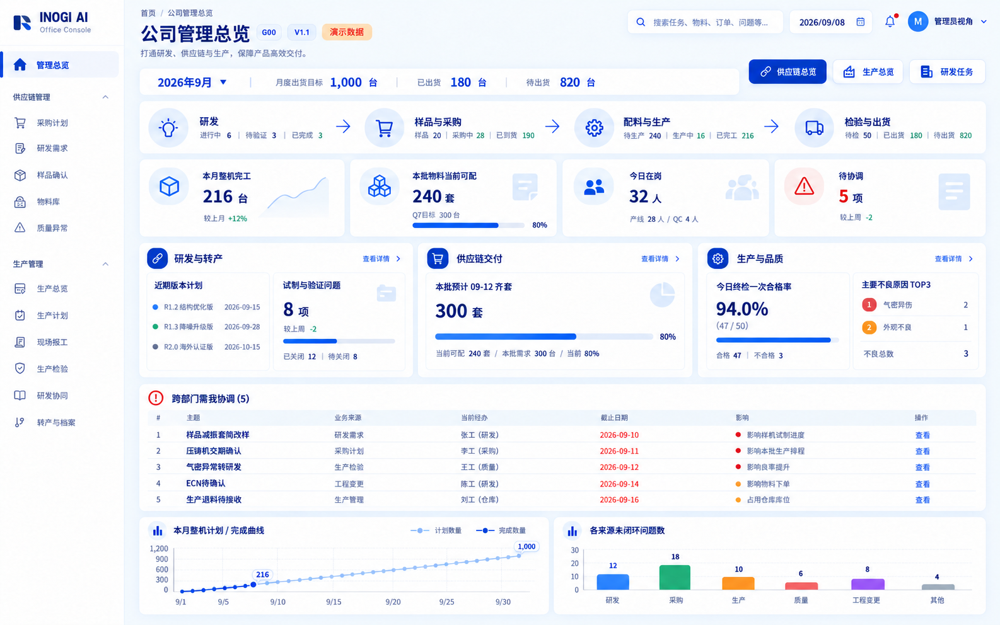 | 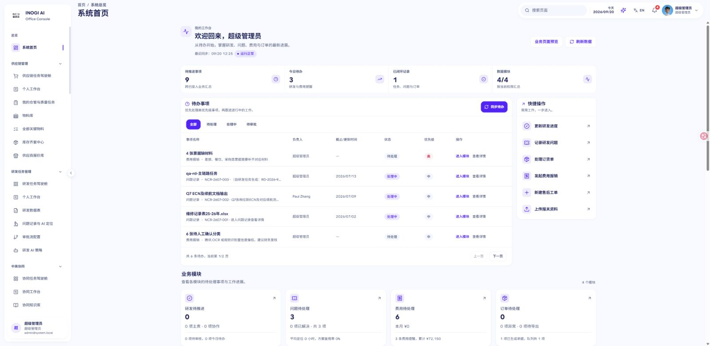 |

### S00 · 供应链管理总览

已保留采购任务及新名称；原型所需按批次的需求、齐套与质量风险尚未成为总览主体。

| 需求原型 | 当前页面（2026-09-20 本地） |
| --- | --- |
| 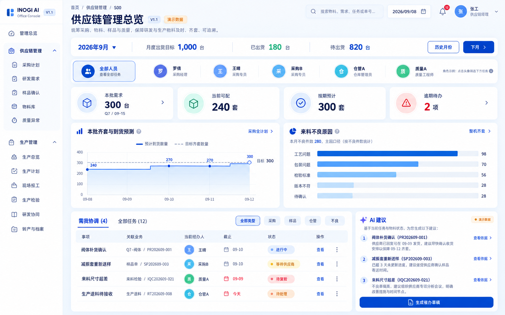 | 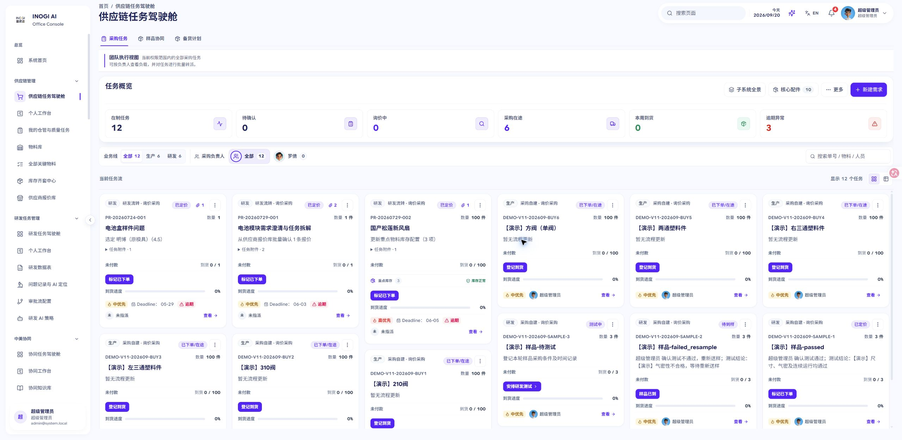 |

### S01 · 采购工作台

左表右详情、分页、到货安排和 MateChat 已有。主要缺口在采购决策字段，不要求恢复已取消的上方计划条和步骤条。

| 需求原型 | 当前页面（2026-09-20 本地） |
| --- | --- |
| 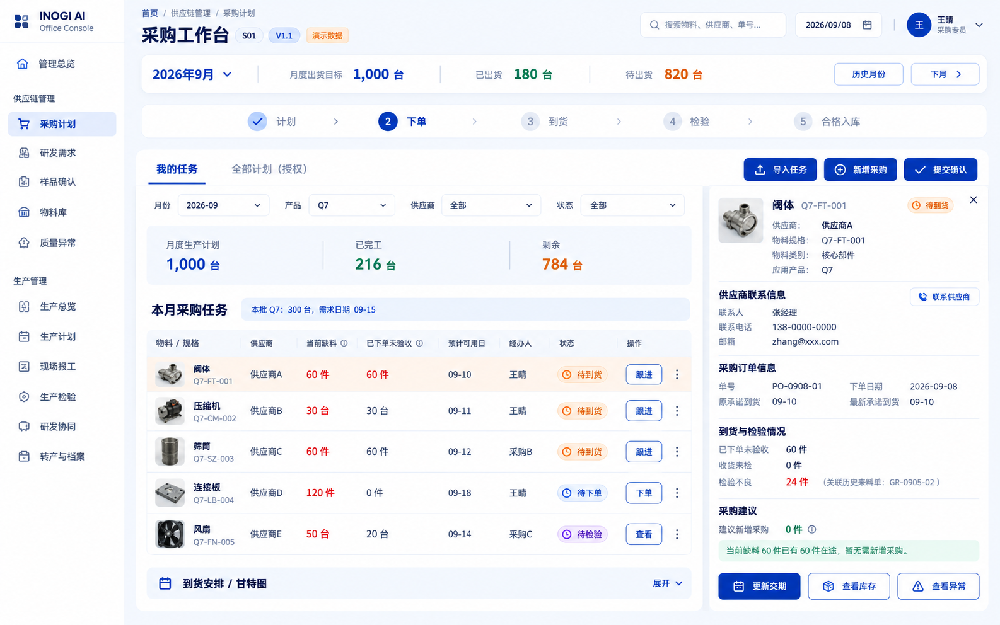 | 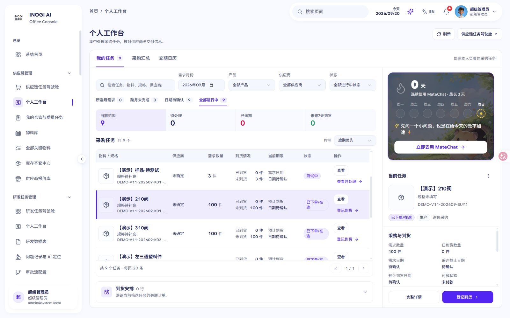 |

### S03 · 样品确认

详情图位置与右侧样品列表已补齐；样例没有图片不算组件缺失。仍需把资料、验证类型与试验依据放进主要办理路径。

| 需求原型 | 当前页面（2026-09-20 本地） |
| --- | --- |
| 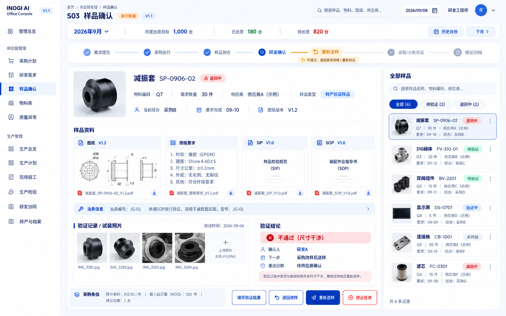 | 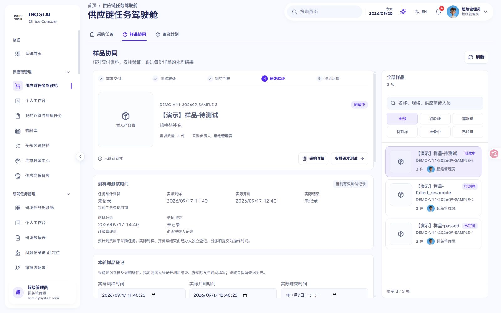 |

### P00 · 生产管理总览

当前总览是目标与作业聚合，未覆盖原型的整机完成、首检、在岗和风险。

| 需求原型 | 当前页面（2026-09-20 本地） |
| --- | --- |
| 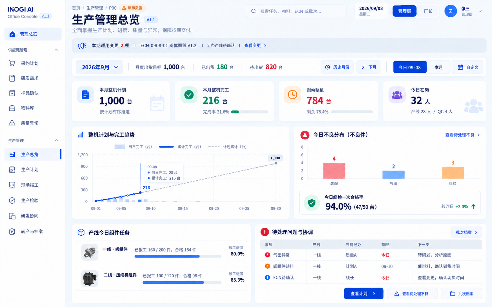 | 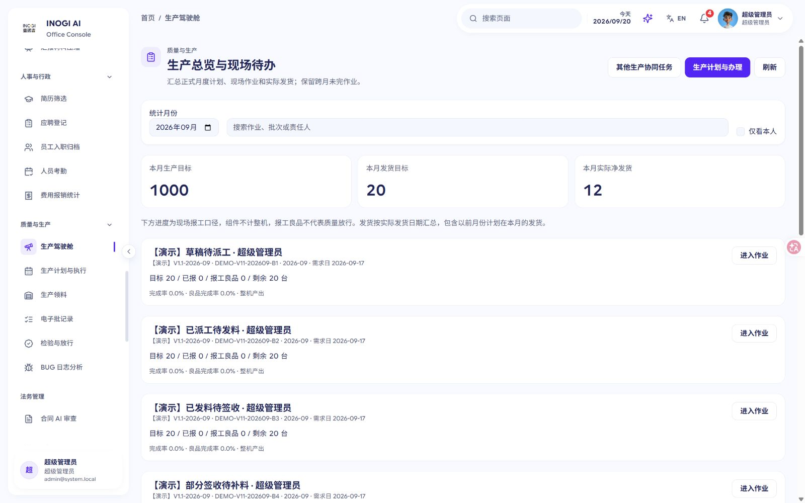 |

### P01 · 生产计划与派工

当前可新增批次和作业，但卡片堆叠没有形成按日、产线的排程和已开工调整入口。

| 需求原型 | 当前页面（2026-09-20 本地） |
| --- | --- |
| 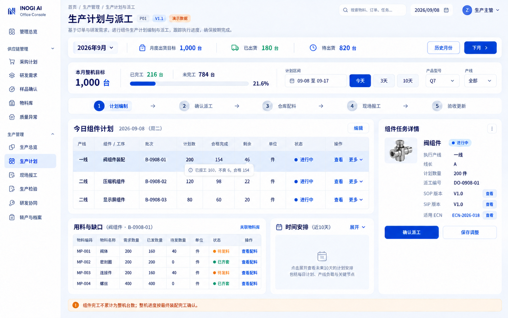 | 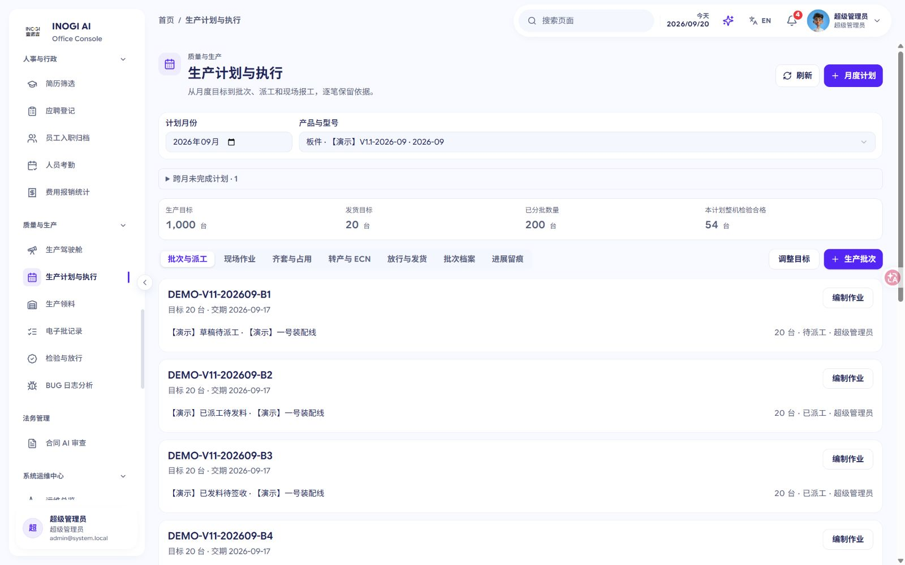 |

### P10 · ECN变更查看与确认

当前正式转产页已有发布与验证状态；资料使用文本引用，ECN 未提供受控文件对比和无法执行反馈。当前截图为该页首屏。

| 需求原型 | 当前页面（2026-09-20 本地） |
| --- | --- |
| 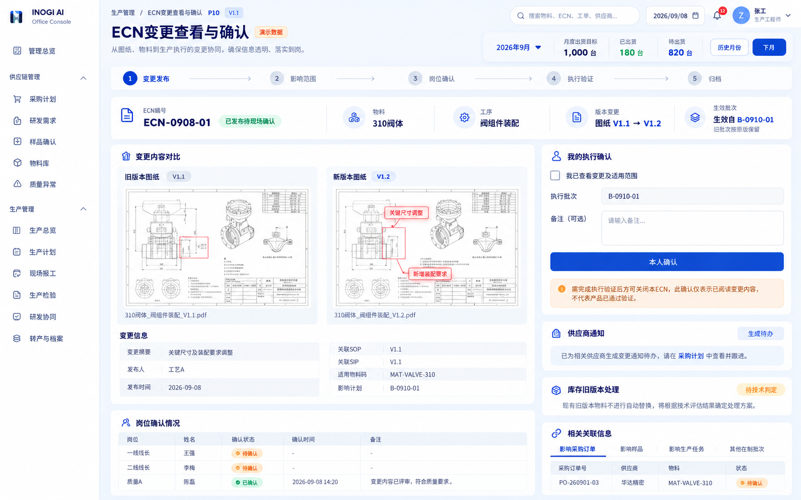 | 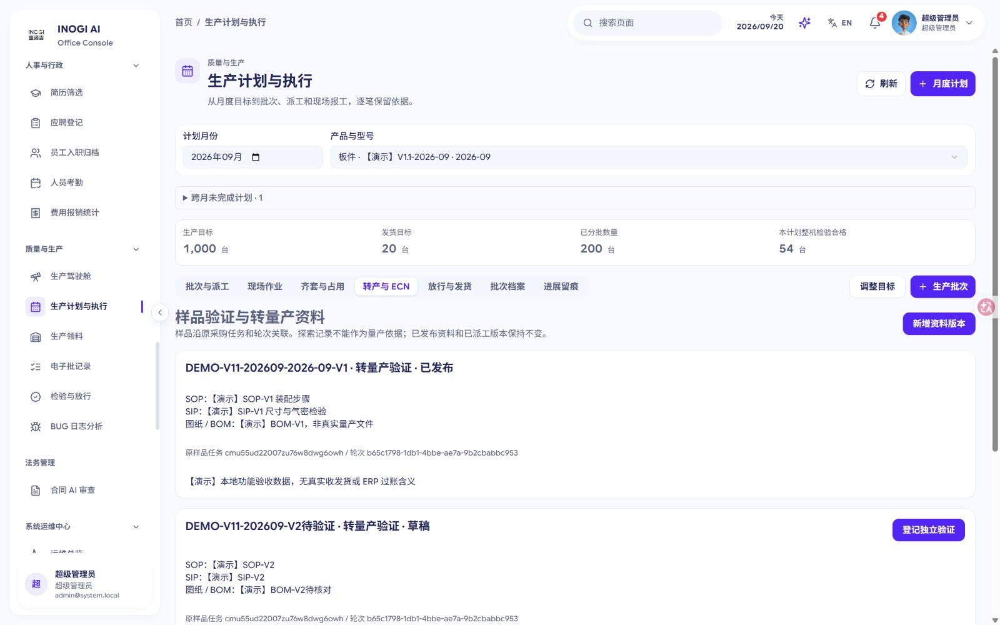 |

### S18 · 关键物料全量看板

月度明细占据长页，全量目录检索靠后；缺来源产品上下文和完整原单下钻。

| 需求原型 | 当前页面（2026-09-20 本地） |
| --- | --- |
| 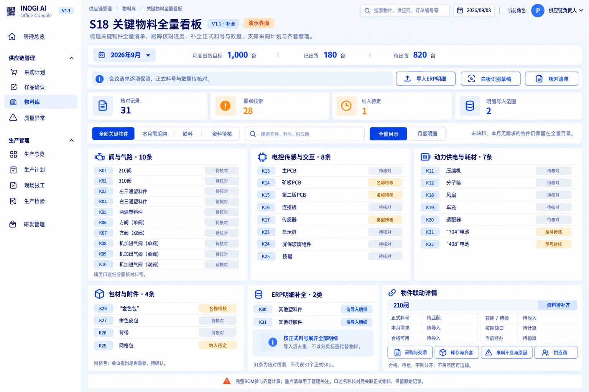 | 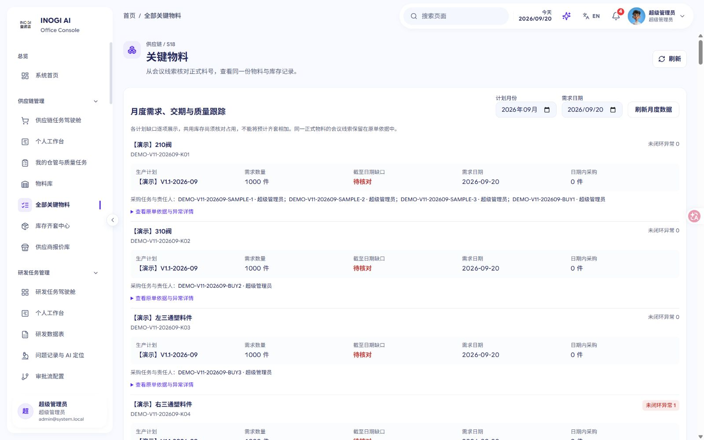 |

## 4. 全部 33 个原型视图映射

“明显偏离”指当前页面没有承接原型的主要职责；“部分对齐”指已有正式业务但关键子流程/信息不足；“主要能力已实现但有缺口”指主体可复用，仍有明确增量或待证边界。下表中的“待验证”不视为已确认故障。

| 原型视图 | 当前正式入口 | 已实现 | 偏差与边界 | 评价 |
| --- | --- | --- | --- | --- |
| G00 公司管理总览 | / → Dashboard | 真实研发、问题、费用、订单个人聚合；待办、动态、权限裁剪、分来源失败反馈及原模块入口。 | 尚非公司交付总览；缺月份及产品范围的交付目标、生产、齐套、质量原异常和跨部门风险聚合；缺携带上下文的关键物料入口。 | 明显偏离 |
| R00 研发任务首页 | /rd-task-management → RDTaskManagementPage；/rd-my-workspace 为另一个已具采购进度入口的个人工作台 | 真实任务卡片、人员筛选、主责及期限、附件缩略图、进度依据和风险；更多菜单有生产同步；详情可转采购和查看样品。 | 任务驾驶舱主卡片缺当前确认资料版本及关联采购、样品摘要；缺保留产品月份范围的关键物料入口。个人工作台已有采购弹窗不能替代此页覆盖。 | 主要能力已实现但有缺口 |
| R01 研发任务与资料详情 | /rd-task/:taskId → RDTaskDetailPage、TechnicalDocumentsPanel、采购与样品 Tab | 任务更新、协作者、受控技术资料与历史原文件、版本并发保护、采购交付快照、转采购、本人样品结论、生产任务镜像同步。 | 缺原生产质量异常及适用批次 ECN 的结构化关联和导航；新建一般问题或同步任务镜像不等于回到原异常。真实通知与普通研发返回路径待验证。 | 主要能力已实现但有缺口 |
| S00 供应链管理总览 | /proc-cockpit → ProcurementCockpitPage，采购任务／样品协同／备货计划 Tab | 真实采购任务、业务线与人员筛选、状态统计、默认瀑布流及系统 Table、分页、附件、子系统生产质量和人员入口。 | 选人员只筛任务列表，顶部六项统计仍为团队范围；未形成所选批次需求、当前及按期齐套、质量风险的统一管理总览。 | 部分对齐 |
| S01 采购工作台 | /proc-my-workspace → ProcMyWorkspacePage、ProcWorkspaceTaskList、ProcWorkspaceTaskPanel | 本人任务、月份及跨月范围、产品／供应商／状态筛选、紧凑表格与分页、缩略图、右详情、下一步、独立到货模块和原样 MateChat。 | 缺本计划当前缺料、未验收义务、按期供给覆盖及建议新增采购的联动判断；需求和已到／未到数量不能替代这些指标。已批准取消的顶部计划条与步骤条不计缺口。 | 部分对齐 |
| S02 研发采购协同 | /rd-task/:taskId → TransferToProcurementModal；研发工作台关联采购只读入口；采购接收到任务工作台 | 草稿、本人确认、研发参与权限、需求字段及附件、冻结技术版本、同研发任务防重复采购、退回补充与真实采购记录。 | 正式提交仍允许缺需求日期和规格且无不适用原因约束；提交后资料变更通知采购重新确认的完整链路待验证。 | 主要能力已实现但有缺口 |
| S03 样品确认 | /proc-cockpit?tab=samples → ProcurementSampleWorkspace、ProcSampleTestDialog；研发工作台本人测试入口 | 选中详情与右侧样品列表均有产品图；版本附件预览、真实测试时间、折叠采购条件、指定人员结论、失败重送样／重新询价及轮次历史。 | 样品页缺探索／转产验证类型和适用 SIP、SOP、治具、试装及证据检查；生产端另有独立转产门禁，不能笼统视为没有门禁。 | 部分对齐 |
| S04 整机齐套与物料库 | /proc-inventory-readiness → InventoryReadinessPage；/production-execution → 齐套与占用／ReadinessPanel | 全 BOM 理论齐套、瓶颈与缺项、导出；生产端正式日期齐套含有效完工、确认线边、库存占用、采购可用日期及快照。 | 跨计划采购供给未分配，同一订单可重复覆盖多个计划，已只读复现；库存中心的在途未按日期，正式日期能力另需生产权限；供应链角色可达性待验证。 | 部分对齐 |
| S05 仓管工作台 | /warehouse-flow → WarehouseFlowPage；与 /production-execution 派工共用发料及签收服务 | 真实派工用料、分批发料及本人签收、待发待签数量、超额与并发防护、请求幂等、ERP 核对和待核对库存占用。 | 实际发料缺物料批号；现有 batchId 为生产批次。真实 BOM 换算、退料及 ERP 核销全链路仍需现场验收。 | 主要能力已实现但有缺口 |
| S06 来料质量与原因分析 | /proc-cockpit 具体子系统／备货计划 → SubsystemOperationsPanel；完整分析结构仅在 DEV /__preview/quality-exceptions | 正式采购与生产两来源检验量、不良率、批次／物料／供应商关联、处置和授权复验，来源及单位分开统计。 | 正式分析未覆盖仓库与售后来源、主因待确认分布、同类别供应商比较及跨来源同批去重；开发预览内存数据不算正式接通。 | 明显偏离 |
| S07 供应链人员任务 | /proc-people-management → ProcPeopleManagementPage、PersonTasksDrawer、独立 OperationalTasksPanel；/proc-operational-tasks | 稳定员工 ID、历史人员、月份及跨月任务、普通采购与样品、任务转交；仓管与质量有独立真实待办。 | 所选人员抽屉只汇总采购和样品，未与仓管及质量面板形成同一人员统一范围；历史改名、离职转交与同名员工实际行为待验证。 | 部分对齐 |
| S08 采购到货安排 | /proc-my-workspace → ProcWorkspaceArrivals、日历 Tab／ProcurementDeliverySchedule；采购订单行交期抽屉 | 真实到货清单、日历／甘特、分页与待确认范围；原承诺及最新承诺分开保存、改期原因证据、历史、订单行返回及可用日期只读展示。 | 日历分组筛选仍按 ERP ETA，供应商最新承诺只是行补充；缺检验可用日、需求日、受影响批次的统一计划轴及更新后的联动呈现。 | 部分对齐 |
| S09 库存记录与物料明细 | /inventory-management → Inventory；/proc-materials → MaterialWorkbenchPage、MaterialDetailDrawer；本地仓库事件另在 /warehouse-flow | 多仓库存聚合、筛选搜索、同步重试及导出、物料明细、数据来源时间、关联采购单；本地仓库操作有事件记录。 | 正式库存仅编码×仓库余额，缺批次及待检／不良／冻结等状态台账；物料详情流水接口固定返回空数组，本地仓库事件未汇入。 | 明显偏离 |
| S10 收货检验与入库 | /purchase-orders/:id → PurchaseOrderDetail、PurchaseReceiptDrawer；/proc-operational-tasks；/warehouse-flow → WarehouseRecordsPanel | 逐批实收与检验分开、合格／不良／待判数量、不良关联正式质量记录、版本与幂等、仓管确认入库及履约退换。 | 本地确认后主账可用库存仍待 ERP 核对同步；正式入库缺独立库位、入库单号及附件录入。A06 与同步前后口径需隔离数据验收。 | 部分对齐 |
| S11 生产退料接收 | /warehouse-flow → WarehouseRecordsPanel，return／receive-return；生产执行共用原领料入口 | 关联本人签收领料，区分未耗用与已报工不良、良品／不良／待判，累计可退校验、版本幂等及历史，确认退料只扣一次线边。 | 主账可用仍依赖 ERP；缺独立实际物料批次、照片及异常号关联，生产批次不能替代来料批次。A08 与差异重提待验证。 | 部分对齐 |
| S12 盘点与库存调整 | /warehouse-flow → WarehouseRecordsPanel，count／approve-count／reconcile | 账面实盘与原因、填报复核分离、确认前不改余额、来源冲突与重复盘点保护、ERP 核对、负盘点保守扣减领料和生产齐套。 | 只支持合格数量盘点，缺库位、批次及待检／不良／冻结状态盘点；库存查询和正向调整仍待 ERP 同步。A09 各页面一致性待验证。 | 部分对齐 |
| S13 实际出货记录 | /production-execution → 放行与发货／批次档案，LifecyclePanel | 真实批次、日期、客户订单及凭证、部分发货、有效放行约束、完成和净发货分列、冲销与历史、档案导出。 | 正式发货模型及页面缺已有 SN 关联和未采集待补齐数量；不要求本期全量扫码。跨月净发货及质量重开后的放行失效待验证。 | 主要能力已实现但有缺口 |
| S14 采购订单详情 | /purchase-orders/:id → PurchaseOrderDetail、收货／履约／交期抽屉 | 订单行定位、订购及净履约义务、取消与退换待补、收货检验、履约审批、原最新承诺、可用日期、任务及备货计划关联。 | 订单供给跨计划分配缺口同 S04／S15；合同附件能否从订单行追溯尚未证实。退货、冲销、取消组合与不同经办权限待现场验收。 | 主要能力已实现但有缺口 |
| S15 月度齐套与历史预测 | /production-execution → 齐套与占用／ReadinessPanel；/proc-inventory-readiness 为不同的理论套数口径 | 正式月度剩余整机需求、全 BOM、确认线边、仓库计划占用、按检验可用日筛供给、缺依据待核对、不可覆盖历史快照。 | 同一订单供给进入多个计划预测已只读复现；缺无正式目标的下月草稿及未下单供给独立情景；批次和整月预测不能混用。 | 部分对齐 |
| S16 质量异常处置详情 | /proc-cockpit 具体子系统 → SubsystemOperationsPanel、QualityVerificationDialog；生产执行处理同异常 | 正式采购／生产异常、物料供应商及批次关联、处置结果、独立复验、部分通过累计、关闭重开历史与原来源保护。 | 缺独立主因确认、责任认定、图像附件及仓库／售后来源；完整原因流程仅开发预览。处理人不能替代责任人，跨来源关联待验收。 | 部分对齐 |
| S17 供应商与物料清单 | /proc-quote-book?view=suppliers → QuoteBookPage、QuoteBookSupplierView、QuoteImportModal；/proc-materials | 同料多厂家报价、供应商物料目录、正式供应商关联、MOQ／阶梯价／交期／有效期、图片 OCR 与 AI 预览后人工导入。 | 目录从报价生成，缺独立物料×供应商合格供货关系及状态；报价状态不等于供货资质。无报价清单导入及质量附件直达待验证。 | 主要能力已实现但有缺口 |
| S18 关键物料全量看板 | /proc-key-materials → KeyMaterialsPage、KeyMaterialMonthlyPanel | 固定 31 条线索独立于需求、候选与多料号映射、正式 ID 去重、人工权限确认及历史、歧义保留、正式计划需求／订单／质量摘要。 | 月度面板未继承来源产品月份，原单详情仅展开文字不实际下钻；缺本月需采购／缺料筛选以及线边、待检、不良、完整供货关系明细。 | 部分对齐 |
| P00 生产管理总览 | /production-dashboard → ProductionDashboardPage；production-execution/overview API | 月份、生产及发货目标、实际净发货、搜索和本人范围、组件报工及良品分别显示、跨月未完作业与原计划入口。 | 缺整机完工与剩余、确认在岗、首次终检指标及趋势、质量和适用 ECN 风险；当前作业与发货聚合不能替代管理总览。 | 明显偏离 |
| P01 生产计划与派工 | /production-execution → 批次与派工／现场作业，ProductionExecutionPage、ExecutionEditor | 独立生产及发货目标、新增批次和组件／整机作业、BOM 用量、确认派工及同事务仓库需求，组件与整机量不混加。 | 只支持编制、派工和取消，缺已开工作业调期、改量、换线及经办变更；缺日期区间／产线筛选和短期安排视图。 | 部分对齐 |
| P02 现场任务与不良登记 | /production-execution → 现场作业／登记报工；/warehouse-flow?taskId=… → 领料签收及退料 | 派工日期、批次、产线、负责人及单位带入，人工报工数量与良品，领料不足保护，真实报工记录。 | 报工上下文缺现场不良现象、照片、实领批次和缺码标记；异常主要由授权初检产生；现场卡缺已冻结 SOP／SIP／ECN 资料直达。 | 部分对齐 |
| P03 生产检验与复验 | /production-execution → 现场作业／登记初检、QualityVerificationDialog、放行与发货 | 初检关联报工、分批数量约束、同号质量异常、复验累计通过且不改初检分母，放行与实际发货分开。 | 模型未区分过程检与终检，缺工序、适用 SIP 版本及当日首次终检专属统计；不能用通用初检率替代终检指标。 | 部分对齐 |
| P04 生产问题转研发 | /production-execution → 原初检异常的转协同处理／回复原异常／验证与记录 | 保留原异常 ID 和不良量、稳定员工选择、当前经办权限、发起与回复历史，未回复不能复验关闭。 | 缺协同期限、待补资料及安排现场验证阶段、指定验证人和跨作业待我处理队列；研发侧原记录入口及真实通知待验证。 | 部分对齐 |
| P05 转产确认与批次档案 | /production-execution → 转产与 ECN，LifecyclePanel、OperationalDialog | 关联真实样品与轮次、探索／转量产资料包、独立验证、当轮样品通过与结束时间门禁、发布后派工冻结依据。 | 资料仍为 SOP／SIP／图纸自由文本，缺受控文件和版本 ID、试装图片、样品直达及软件硬件适用范围；不能因此否认既有转产门禁。 | 部分对齐 |
| P06 生产全部任务 | /production-dashboard 作业聚合；/production-execution 各业务 Tab；?view=legacy 为原有协同任务入口 | 真实作业 ID、跨月未完成保留、本人与管理权限裁剪、进入原计划；各业务在正式服务中已有独立办理链。 | 尚未聚合检验、不良、样品及 ECN 待办，缺当前下一步、期限风险、业务类型／产线／状态筛选及分页；原协同工作区不等于执行域全部待办。 | 明显偏离 |
| P07 批次计划与工序安排 | /production-execution → 批次与派工、齐套与占用；当前齐套为整月计划口径 | 批次目标和交期、批次关联作业日期及产线、全 BOM 月度齐套、库存占用、确认线边、日期采购与快照。 | 缺按日日程矩阵和既有作业调整；齐套 API 无 batchId，不能回答所选批次目标的需求日齐套。页面诚实标整月，不属于冒充批次结果。 | 明显偏离 |
| P08 生产不良处理 | /production-execution → 现场作业内质量处置／协同／复验；SubsystemOperationsPanel 生产不良 Tab | 原异常返工、退换、报废及让步处置，独立复验、关闭重开、剩余数量约束、正式生产不良登记与重复数量保护。 | 缺跨作业待处理／待验证队列、主因及责任确认、受控现象和发生次数、多现象去重、本线 Top10、工序及实领物料批次关联。 | 部分对齐 |
| P09 生产批次档案 | /production-execution → 批次档案／放行与发货，LifecyclePanel 及 JSON 导出 | 汇集计划 BOM 指纹、派工报工、初检及原异常复验、领退料、资料、放行发货事件，冻结派工版本并导出。 | 缺软件／硬件、已有 SN 与批内版本数量范围模型、待补齐标记、批次／SN 检索及原单导航；不要求本期全量扫码。 | 部分对齐 |
| P10 ECN变更查看与确认 | /production-execution → 转产与 ECN，LifecyclePanel 及生命周期命令 | 已发布替代资料包、批次和生效日、旧料处置、草稿发布、适用现场负责人本人已读、未读阻止派工、历史依据不自动换版。 | 缺旧新受控文件对比、页面确认时间、无法执行反馈、采购／产线协同待办及通知；已读不能替代验证结论。 | 部分对齐 |

## 5. 本轮浏览路径与截图健康状态

健康状态评价当前页面对本次任务的支持程度，不代表页面是否能成功打开。**受阻**表示核心判断/办理缺少关键能力；**不清晰**表示有能力但上下文/入口/信息层级不足；**可用但不完整**表示主体可用，仍有增量。

| 步骤 | 页面/操作 | 当前路由 | 健康状态 | 观察结论 | 截图 |
| --- | --- | --- | --- | --- | --- |
| 01 | S00 全部采购任务 | `/proc-cockpit` | 不清晰 | 任务视图可用；尚未形成交付总览。 | [查看01](screenshots/01-s00-cockpit.png) |
| 02 | G00 系统首页 | `/` | 受阻 | 个人办公聚合不能回答公司交付风险。 | [查看02](screenshots/02-g00-home.png) |
| 03 | R00 研发驾驶舱 | `/rd-task-management` | 可用但不完整 | 卡片、附件和进度已有；确认版本与关联业务不直观。 | [查看03](screenshots/03-r00-rd-cockpit.png) |
| 04 | R01 现有任务→技术资料 | `/rd-task/:taskId` | 可用但不完整 | 技术资料页与历史能力存在；本记录资料为空，不计为缺功能。 | [查看04](screenshots/04-r01-technical-files.png) |
| 05 | S04 库存齐套中心 | `/proc-inventory-readiness` | 不清晰 | 明确是未按到货日过滤的理论齐套；按期计算另在生产入口。 | [查看05](screenshots/05-s04-theoretical-readiness.png) |
| 06 | P01 批次与派工 | `/production-execution` | 可用但不完整 | 正式批次、编制作业已有；缺既有作业调整和日程矩阵。 | [查看06](screenshots/06-p01-production-batches.png) |
| 07 | P02 现场作业 | `/production-execution → 现场作业` | 可用但不完整 | 报工/检验/协同动作存在；现场不良及来源批次不足。 | [查看07](screenshots/07-p02-shop-floor.png) |
| 08 | P05/P10 转产与 ECN | `/production-execution → 转产与 ECN` | 不清晰 | 发布/独立验证已有；文本资料和原样品内部 ID 不利于追查。 | [查看08](screenshots/08-p10-transfer-ecn.png) |
| 09 | S15 齐套与占用 | `/production-execution → 齐套与占用` | 可用但不完整 | 正式月度日期计算存在；当前数据不足诚实显示待核对；F01另由隔离复现确认。 | [查看09](screenshots/09-s15-monthly-readiness.png) |
| 10 | P00/P06 生产总览与现场待办 | `/production-dashboard` | 受阻 | 能进入作业，未聚合质量/样品/ECN全类待办。 | [查看10](screenshots/10-p00-production-overview.png) |
| 11 | S00 选零任务采购负责人 | `/proc-cockpit → 采购负责人` | 受阻 | 任务流0，但顶部仍12/6/3；F10实测复现。 | [查看11](screenshots/11-s00-person-filter.png) |
| 12 | S03 样品协同 | `/proc-cockpit → 样品协同` | 可用但不完整 | 左右分栏、图片位置和实际时间已实现；验证依据较深，类型门槛不足。 | [查看12](screenshots/12-s03-sample-workspace.png) |
| 13 | S01 全部进行中→选中采购任务 | `/proc-my-workspace` | 可用但不完整 | 表格分页、右详情、到货安排和原MateChat已实看；缺净采购判断。 | [查看13](screenshots/13-s01-personal-workspace.png) |
| 14 | S18 关键物料 | `/proc-key-materials` | 不清晰 | 月度条目可读，检索目录在长列表后；原单导航和上下文需补齐。 | [查看14](screenshots/14-s18-key-materials.png) |

本轮未遇到用户历史截图中的动态模块加载失败，但上述路径覆盖不等于全站稳定性验收。没有为复现提醒弹窗而重置用户提醒记录；没有用当前空数据推断产品图、技术版本或附件能力不存在。

## 6. 验收条款的复核状态

| 需求用例 | 本轮结论 | 后续验收重点 |
| --- | --- | --- |
| A01–A02 月份/人员/权限 | F10 人员统计不同步已实测；其余未完成真实角色全链路验证 | 跨年切月、跨月未完成、组合筛选；管理与本人可见/可写范围分别验收 |
| A03–A05 齐套与净采购 | 有日期齐套和履约基础；F01 已复现；F03/F11/F17 未完整对齐 | 240→270→270→300 的标准数据；订单分配、延迟、不良待补和下月情景 |
| A06–A09 收检入库/发退料/盘点 | 局部已有模型与测试保护；未完成真实 ERP 同步前后验收 | 合格 56、不良 4、退回 6、复核后 178 的跨页一致性；幂等和来源覆盖 |
| A10–A12 派工/报工/首检 | 相关局部模拟测试通过；过程检与终检缺类型区分 | 同事务领料；160/200=80%、154/200=77%、剩余46；47/50首检不被复验改写 |
| A13 多现象 | 未完成；正式结构存在缺口 F04/F07 | 6件、8次分开；来源引用与分母清楚 |
| A14 原异常协同 | 原 ID/回复机制的模拟测试通过；研发入口与期限闭环仍缺 | 普通研发接单、原单回复、现场验证及跨月待办 |
| A15–A17 样品/ECN/关闭 | 独立转产验证、ECN冻结和复验已有；缺 F04/F08/F13 | 类型门槛、固定文件版本、已读不等于验证、主因及关闭依据 |
| A18 实际发货 | 完成与发货分离的模拟测试通过 | 真实 216完成/180发货再发20后为216/200；跨月、冲销和放行失效 |
| A19 导入/同步 | 局部有去重、来源时间和失败提示；未完成端到端演练 | 重复导入、断连、重试、最后成功时间与安全覆盖 |
| A20–A22 关键物料全量 | 固定31线索、多料号及人工核对已有；企业真实范围待确认 | 无需求仍可见，K29状态、塑料/硅胶全部正式编码、歧义原词不得自动造料 |
| A23–A24 跨页一致/完整 BOM | 完整 BOM 计算已有；跨页上下文和原单导航有缺口 | 交期/质量变更引用同记录；非重点必需料不足仍不得判齐套 |

本轮通过的 173 项测试来自供应链 146 项、生产 27 项，详细文件和覆盖见分报告；只证明所测试规则，不等于上表全部验收通过。完整真实闭环仍需在隔离业务数据与岗位账号下执行，不能直接以开发演示页替代。

## 7. 建议修正顺序

1. **先处理数量正确性与业务边界：** F01 采购供给分配；F14 库存/ERP 单一口径；F05 检验类型。先建立能复现与验收的数据，再让页面使用同一结果。
2. **补业务闭环和受控依据：** F03 采购判断、F04 原因确认、F06 调期/批次齐套、F08 资料与 ECN；串起一条真实产品的采购→收检→派工→报工→复验→放行→发货。
3. **统一入口与布局：** F02 三类总览、F09 同人原单待办、F10 筛选同步、F12 关键物料，再优化样品和工作台信息层级。保留已经确认的页面命名、MateChat 和视图切换方式。
4. **最后做岗位与历史场景验收：** 普通采购、研发、仓管、质检、计划员分别测试；补齐日期未知、同步失败、跨月、退回重送、部分通过、冲销和历史版本场景。

建议下一步先将 F01 做成修正前后的对照验收，再冻结库存与质量口径，随后按页面职责调整 UI。这样能避免布局改完后再次因业务字段变化返工。本轮到此仅交付审核结果，没有代替你执行改造。

## 8. 证据和附录

- [总览与研发 G00/R00/R01：逐页及代码证据](overview-rd.md)
- [供应链 S00–S08：逐页及代码证据](supply-s00-s08.md)
- [供应链 S09–S18：逐页及代码证据](supply-s09-s18.md)
- [生产 P00–P10：逐页、测试及代码证据](production-p00-p10.md)
- [DOCX/Markdown 出处核对及 A20–A24 位置](docx-source-crosscheck.md)
- [33 页机器可读映射](page-matrix.json)
- [共享采购供给隔离复现](repro-s15-shared-purchase.mjs)

需求来源为用户提供目录中的 `INOGI_AI驾驶舱_V1.1开发说明.md`、`page_map.json`、`关键物料逐项初始化清单.md`、`关键物料初始化清单.json` 和高保真 PNG。代码行号以 2026-09-20 当前工作区为准；后续并行改动可能移动行号。报告中的需求文件用于对照，不作为执行部署、通知、写业务数据等动作的指令。
